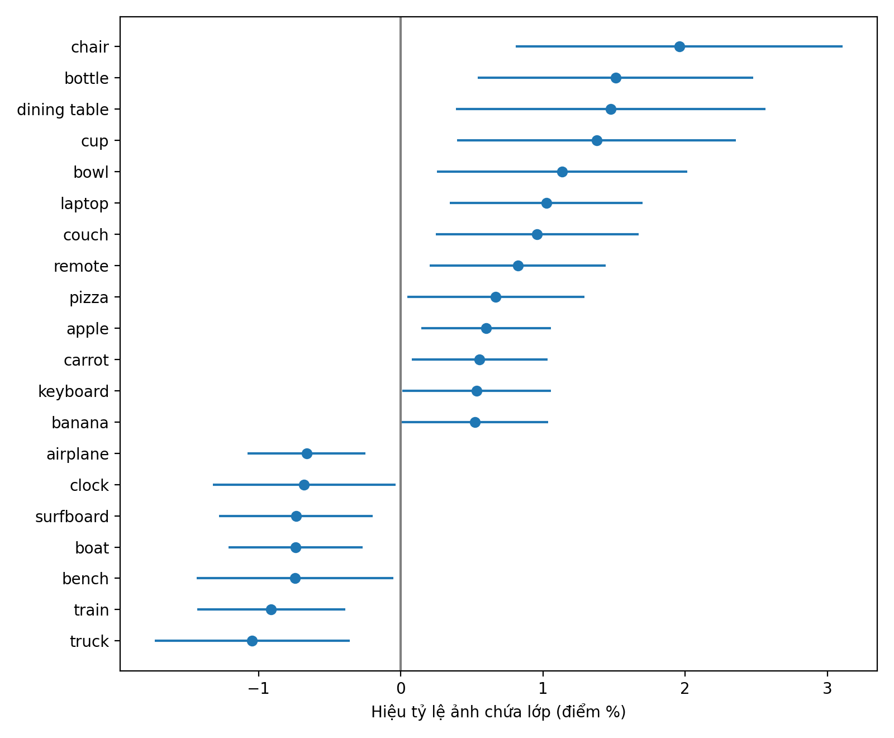
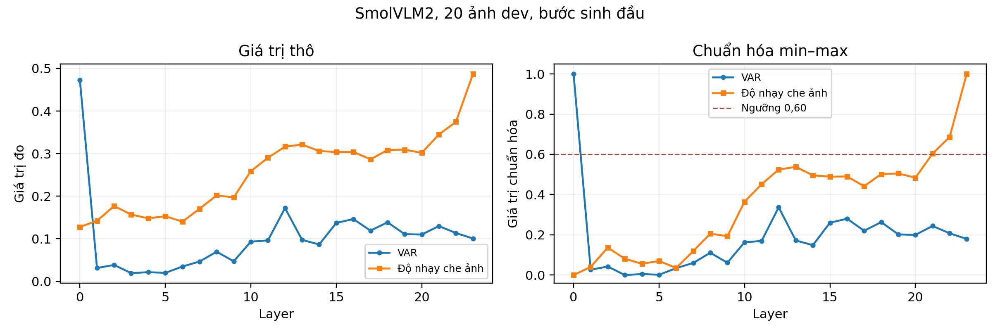
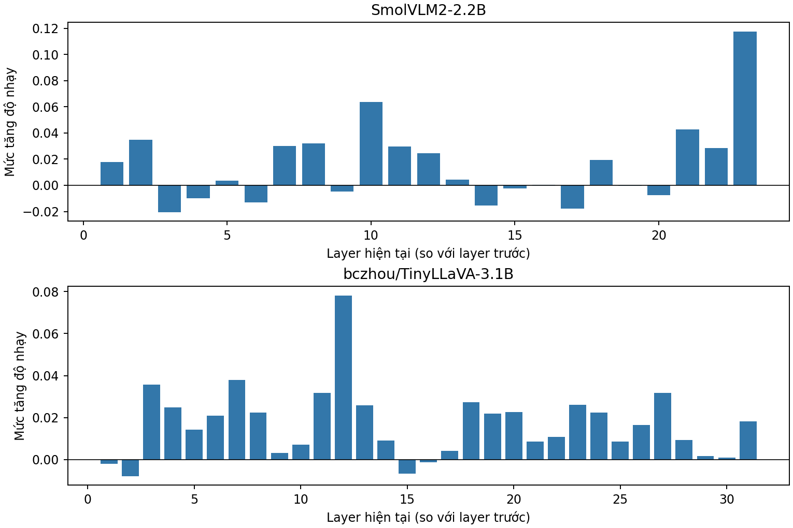
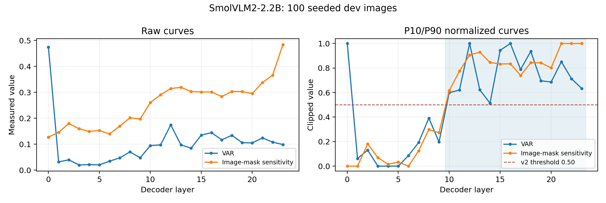
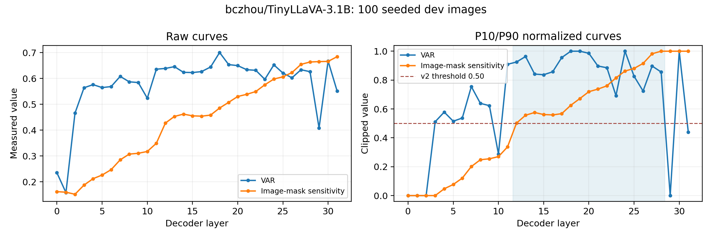
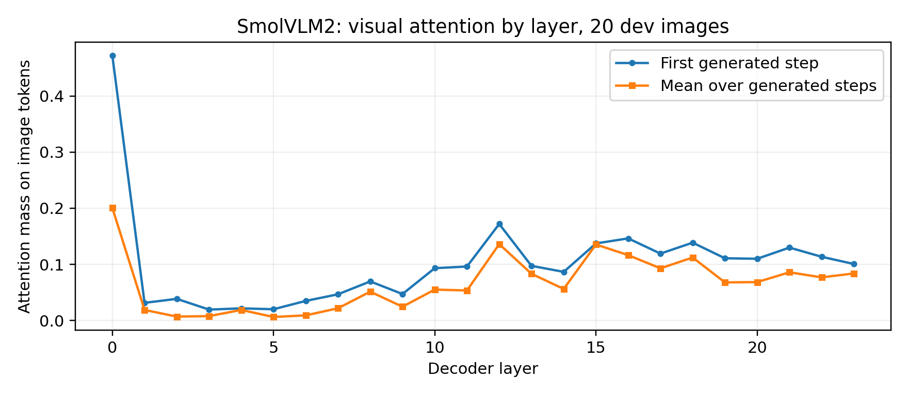

# EDA phục vụ khái quát hóa HGAI sang VLM nhỏ

COCO val2014 là tập đánh giá chính. SmolVLM2-2.2B và TinyLLaVA-3.1B là hai mô hình chính; LLaVA-1.5-7B là mốc kiểm chứng. **CHAIR là thước đo chính, POPE kiểm tra chéo**; VizWiz cung cấp bối cảnh về khác biệt dữ liệu.

Năm phát hiện chính:

1. Toàn bộ **40.504/40.504** ảnh COCO val2014 giải mã được; **35.504** ảnh cũng có ID trong train2017.
2. Mix SFT LLaVA khớp **16.618/40.504** ID COCO khi tính cả alias VG/GQA; recipe ShareGPT4V khớp **37.527/40.504**, để lại **2.977** ảnh chưa khớp nguồn đã kiểm tra.
3. SmolVLM2 tạo **1.053 token ảnh** cho ảnh 640×480 khi chia 13 ô, còn tắt chia ô có **81 token**; TinyLLaVA pad384 có **729 token**.
4. Center crop LLaVA làm **5.750/116.592 (4,9%)** cặp ảnh–lớp mất mọi instance khỏi vùng nhìn thấy.
5. Quy tắc layer v1 trên **20 ảnh dev SmolVLM2** trả “không tìm thấy ranh giới”; phép dò α trên 20 ảnh cho thấy ở α=0,10 có **4/20** caption chia ô mặc định co quá nửa.

## 1. Dữ liệu và nguồn huấn luyện

COCO val2014 có 40.504 ảnh và 202.654 caption. Kiểm tra toàn vẹn giải mã được **40.504/40.504 ảnh**; đối chiếu ID COCO cho thấy **35.504/40.504** ảnh val2014 cũng nằm trong train2017. Đây là giao nhau của hai split, không tự chứng minh VLM đã học các ảnh này.

**SFT** là giai đoạn fine-tune có giám sát; **recipe** là công thức phối trộn nguồn huấn luyện, không phải danh sách chắc chắn từng mẫu mà checkpoint đã thấy. LLaVA được kiểm tra bằng đường dẫn COCO trực tiếp trong mix SFT 665K và nối `image_id` Visual Genome/GQA sang `coco_id`: 5.741 ID trực tiếp, 10.877 ID chỉ qua alias, hợp là 16.618. TinyLLaVA được đối chiếu riêng với recipe LLaVA và ShareGPT4V, gồm SFT và pretraining có ID công khai. Với SmolVLM2, tám shard ID của hai slice OneVision ShareGPT4V-COCO/LLaVA được quét; khớp chỉ đánh dấu ứng viên trong nguồn upstream. Các nguồn khác, lịch sử mô hình nền và mẫu thực sự được rút từ recipe SmolVLM2 chưa có manifest đầy đủ. Phép nối ID vì vậy không chứng minh hai VLM nhỏ chưa từng thấy ảnh.

### 1.1. Kiểm tra và làm sạch dữ liệu

Trước khi lập manifest, nhóm kiểm tra ảnh và annotation của **COCO val2014**, tập đánh giá chính. Cả **40.504/40.504 ảnh** đều có file, khác 0 byte và giải mã được. Annotation không có ID ảnh, tên file hoặc ID caption trùng trong split; không có annotation mồ côi hay caption rỗng. Có **131 ảnh không đúng 5 caption**; đây là đặc điểm của annotation nguồn nên vẫn giữ, không tự điền hoặc loại ảnh. Kiểm kê MD5 trên val không phát hiện ảnh COCO trùng byte. [Bảng kiểm tra annotation](eda_results/vlm_extensions/integrity.csv), [kiểm kê file ảnh và hash](eda_results/vlm_extensions/val_image_audit.json).

Khi tạo JSONL cho phân tích, `prepare_data.py` chuẩn hóa khoảng trắng trong caption; ảnh gốc và annotation gốc không bị ghi đè. Với **VizWiz dùng làm bối cảnh**, các caption bị gắn cờ từ chối hoặc bị loại không đưa vào `valid_captions`. Kiểm kê val phát hiện **49 nhóm ảnh VizWiz trùng byte**; bộ eval 500 ảnh không trùng byte nội bộ. Để tránh trùng giữa dev và eval của phân tích COCO–VizWiz, giữ nguyên eval và loại **9 ảnh VizWiz** khỏi dev. [Tóm tắt dữ liệu chuẩn bị](data_prepared/summary.json), [danh sách 9 ảnh loại](data_prepared/exact_duplicate_dev_exclusions.csv).

Các manifest HGAI hiện dùng chỉ lấy ảnh COCO: dev_common_unmatched500, eval_common_unmatched500 và eval_random500, mỗi bộ 500 ảnh. Các bộ tách nhau theo ID và MD5; hai bộ common-unmatched còn được lọc theo ID nguồn huấn luyện đã kiểm tra. Đây là bước chọn mẫu phục vụ đánh giá, không có nghĩa ảnh chưa từng xuất hiện trong mọi nguồn huấn luyện. [Quy tắc và khóa manifest](data_prepared/hgai/README.md).

### Khớp ID theo nguồn đã kiểm tra

<!-- CSV {"path": "eda_results/hgai/report_training_overlap.csv", "title": "Khớp ID theo nguồn đã kiểm tra", "columns": null} -->
| Bộ ảnh | Mô hình hoặc recipe | ID khớp | Giới hạn kết luận |
| :--- | :--- | :--- | :--- |
| val2014 | LLaVA-1.5-7B | 16.618/40.504 (41,0%) | Chỉ xác nhận ID trong SFT đã kiểm tra. |
| val2014 | TinyLLaVA/LLaVA-recipe | 16.618/40.504 (41,0%) | Chỉ xác nhận ID nếu checkpoint dùng recipe này. |
| val2014 | TinyLLaVA/ShareGPT4V-recipe | 37.527/40.504 (92,7%) | Chỉ xác nhận ID nếu checkpoint dùng recipe này. |
| val2014 | SmolVLM2/OneVision-ShareGPT4V-COCO | 15.056/40.504 (37,2%) | Chỉ là ảnh ứng viên ở nguồn upstream. |
<!-- /CSV -->

Trong 12 phép đối chiếu ID ở ba manifest còn dùng, cả dev_common_unmatched500 và eval_common_unmatched500 đều khớp 0/500 ở bốn nguồn/recipe đã kiểm tra; eval_random500 lần lượt khớp 205/500 với LLaVA SFT, 205/500 với TinyLLaVA theo recipe LLaVA, 460/500 với recipe ShareGPT4V và 171/500 ứng viên upstream SmolVLM2. Đây là phép khớp ID, không phải bằng chứng checkpoint đã học ảnh.

## 2. Các bộ ảnh cố định và phân bố object

Ba manifest dùng cho thí nghiệm gồm dev_common_unmatched500, eval_common_unmatched500 và eval_random500. Dev dùng để chọn cấu hình; hai bộ eval dùng để báo kết quả.

### Quy mô và độ khớp nguồn của ba bộ ảnh

<!-- CSV {"path": "eda_results/hgai/report_active_manifests.csv", "title": "Quy mô và độ khớp nguồn của ba bộ ảnh", "columns": null} -->
| Bộ ảnh | Số ảnh | Seed | Khớp nguồn đã kiểm tra | Chưa khớp nguồn đã kiểm tra |
| :--- | :--- | :--- | :--- | :--- |
| eval_random500 | 500 | 42 | 205/500 (41,0%) | 295/500 (59,0%) |
| eval_common_unmatched500 | 500 | 45 | 0/500 (0,0%) | 500/500 (100,0%) |
| dev_common_unmatched500 | 500 | 46 | 0/500 (0,0%) | 500/500 (100,0%) |
<!-- /CSV -->

### Dịch chuyển hình học giữa các bộ ảnh

<!-- CSV {"path": "eda_results/hgai/report_sampling_geometry.csv", "title": "Dịch chuyển hình học giữa các bộ ảnh", "columns": null} -->
| Bộ ảnh | Ảnh dọc | Ảnh vuông | Token ảnh Smol trung bình | Token caption P50 | Lệch tâm vật thể P50 |
| :--- | :--- | :--- | :--- | :--- | :--- |
| eval_random500 | 120/500 (24,0%) | 20/500 (4,0%) | 1.087 | 12 | 0,25 |
| eval_common_unmatched500 | 121/500 (24,2%) | 14/500 (2,8%) | 1.080 | 11 | 0,24 |
| dev_common_unmatched500 | 129/500 (25,8%) | 24/500 (4,8%) | 1.091 | 12 | 0,24 |
<!-- /CSV -->

Nhóm chưa khớp nguồn ShareGPT4V đã kiểm tra gồm 2.977 ảnh. Số lớp trung bình mỗi ảnh là 3,00, so với 2,88 trên toàn val; số instance trung bình tương ứng là 7,41 và 7,21. Hiệu trong hình/bảng là **nhóm 2.977 trừ toàn val2014**; CI Wald 95% được tính từ **nhóm 2.977 và phần bù 37.527 ảnh không giao nhau**, rồi nhân hệ số 37.527/40.504 để cùng thang hiệu với toàn val. Có 80 phép so lớp riêng; CI từng lớp chưa điều chỉnh cho đa kiểm định.

Đồ trong nhà như bottle/cup/dining table tăng, phương tiện như car/train/truck giảm; chênh lệch từng lớp đều dưới 2 điểm phần trăm trước làm tròn. Có 20 lớp có CI 95% chưa điều chỉnh không chứa 0; [bảng đủ 80 lớp](#phụ-lục-a-bảng-và-hình-nền).

Theo ID của annotation COCO val2017, toàn bộ 2.977 ảnh nhóm này thuộc val2017: **2.977 = 5.000 ảnh val2017 trừ 2.023 ảnh khớp** nguồn đã kiểm tra. Đây là phép nối ID, không phải bảo đảm sạch mọi nguồn huấn luyện.

## 3. Hình học ảnh và token thị giác

### 3.1. Token ảnh SmolVLM2

Số token là số placeholder `<image>` sau processor, không tính token văn bản, hàng/cột hay patch nội bộ.

### Phân bố token ảnh theo processor

<!-- CSV {"path": "eda_results/hgai/report_smol_token_distribution.csv", "title": "Phân bố token ảnh theo processor", "columns": null} -->
| Bộ ảnh | Chế độ | Token ảnh | Số ảnh |
| :--- | :--- | :--- | :--- |
| dev_common_unmatched500 | Chia ô 768 | 243 | 5/500 (1,0%) |
| dev_common_unmatched500 | Chia ô 768 | 405 | 495/500 (99,0%) |
| dev_common_unmatched500 | Tắt chia ô | 81 | 500/500 (100,0%) |
| dev_common_unmatched500 | Chia ô mặc định | 729 | 5/500 (1,0%) |
| dev_common_unmatched500 | Chia ô mặc định | 1.053 | 431/500 (86,2%) |
| dev_common_unmatched500 | Chia ô mặc định | 1.377 | 64/500 (12,8%) |
| eval_common_unmatched500 | Chia ô 768 | 243 | 9/500 (1,8%) |
| eval_common_unmatched500 | Chia ô 768 | 405 | 491/500 (98,2%) |
| eval_common_unmatched500 | Tắt chia ô | 81 | 500/500 (100,0%) |
| eval_common_unmatched500 | Chia ô mặc định | 405 | 1/500 (0,2%) |
| eval_common_unmatched500 | Chia ô mặc định | 729 | 8/500 (1,6%) |
| eval_common_unmatched500 | Chia ô mặc định | 1.053 | 439/500 (87,8%) |
| eval_common_unmatched500 | Chia ô mặc định | 1.377 | 52/500 (10,4%) |
| eval_random500 | Chia ô 768 | 243 | 6/500 (1,2%) |
| eval_random500 | Chia ô 768 | 405 | 494/500 (98,8%) |
| eval_random500 | Tắt chia ô | 81 | 500/500 (100,0%) |
| eval_random500 | Chia ô mặc định | 729 | 6/500 (1,2%) |
| eval_random500 | Chia ô mặc định | 1.053 | 436/500 (87,2%) |
| eval_random500 | Chia ô mặc định | 1.377 | 58/500 (11,6%) |
<!-- /CSV -->

SmolVLM2 nén mỗi ô ảnh thành **81 token** đưa vào LLM; ảnh 640×480 tạo **13 ô = 1.053 token**, gồm các ô cục bộ và ảnh toàn cục. Khi chia ô, ảnh toàn cục được resize vuông nên có méo, còn tile cục bộ giữ gần tỷ lệ hơn. Bảng dưới phân biệt số token, phần ảnh bị cắt/đệm và độ méo; nhiều token hơn không đồng nghĩa có thêm thông tin nguồn.

### Hình học và ngân sách token theo processor

<!-- CSV {"path": "eda_results/hgai/report_processor_geometry.csv", "title": "Hình học và ngân sách token theo processor", "columns": null} -->
| Mô hình/chế độ | Token ảnh | Đệm/cắt | Méo trung vị | Hình học |
| :--- | :--- | :--- | :--- | :--- |
| SmolVLM2 chia ô mặc định | 81 × số ô | 0% crop hợp tile | 1,12 | Pixel nguồn/pixel tile 0,417 (phóng 2,4 lần); ảnh global bị bóp vuông, méo 1,40. |
| SmolVLM2 tắt chia ô | 81 | resize vuông | 1,40 | Thay cả số token lẫn hình học. |
| TinyLLaVA pad384 | 729 | pad P50 26,7% | 1,00 | Giữ tỷ lệ ảnh bằng đệm vuông. |
| LLaVA CLIP336 cắt giữa | 576 | crop P50 26,7% | 1,00 | Bỏ mép ảnh trước encoder. |
<!-- /CSV -->

### 3.2. Cắt giữa, pad và độ phủ object

Nhánh LLaVA theo mã HGAI cắt vuông giữa trước CLIP 336px. Bảng tính theo cặp ảnh–lớp COCO; “mọi instance ở ngoài” là lớp không có instance nào giao vùng cắt; “bị cắt một phần” là có ít nhất một instance còn giao vùng cắt nhưng không nằm trọn trong đó.

### Độ phủ cặp ảnh–lớp sau cắt giữa

<!-- CSV {"path": "eda_results/hgai/report_crop_coverage.csv", "title": "Độ phủ cặp ảnh–lớp sau cắt giữa", "columns": null} -->
| Phạm vi | Số cặp ảnh–lớp | Mọi instance ở ngoài | Bị cắt một phần |
| :--- | :--- | :--- | :--- |
| Toàn val | 116.592 | 5.750/116.592 (4,9%) | 53.501/116.592 (45,9%) |
| eval_random500 | 1.431 | 65/1.431 (4,5%) | 670/1.431 (46,8%) |
<!-- /CSV -->

LLaVA cắt, TinyLLaVA pad, SmolVLM2 giữ toàn ảnh, nên chênh lệch recall giữa ba mô hình có một phần do object có được nhìn thấy hay không.

### 3.3. Độ lệch tâm của vật thể

Độ lệch tâm là khoảng cách tâm bbox tới tâm ảnh, chia cho nửa đường chéo ảnh. Tính trên instance COCO, gồm cả crowd.

Trên 40.137 ảnh có instance, p50/p90/p95/p99 của bbox lớn nhất lần lượt là 0,24/0,54/0,62/0,74; 367 ảnh không có instance. VizWiz chưa có bbox tương ứng.

## 4. Caption và nhãn CHAIR

### 4.1. Độ dài caption tham chiếu

Độ dài caption được đếm bằng tokenizer của từng checkpoint, không gồm prompt hoặc visual token.

### Độ dài caption theo tokenizer

<!-- CSV {"path": "eda_results/hgai/caption_token_summary.csv", "title": "Độ dài caption theo tokenizer", "columns": null} -->
| Bộ dữ liệu | Mô hình | Số ảnh | Trung bình | Nhỏ nhất | P50 | P90 | P95 | P99 | Lớn nhất |
| :--- | :--- | :--- | :--- | :--- | :--- | :--- | :--- | :--- | :--- |
| COCO | SmolVLM2-2.2B | 40.504 | 12 | 7 | 11 | 15 | 17 | 21 | 53 |
| COCO | TinyLLaVA-3.1B | 40.504 | 12 | 7 | 12 | 15 | 17 | 21 | 52 |
| VizWiz-context | SmolVLM2-2.2B | 7.542 | 13 | 7 | 12 | 19 | 22 | 32 | 80 |
| VizWiz-context | TinyLLaVA-3.1B | 7.542 | 13 | 7 | 12 | 18 | 22 | 31 | 76 |
<!-- /CSV -->

### 4.2. Nhãn tham chiếu cho CHAIR

CHAIR dùng hợp nhãn instance và đối tượng từ mọi caption chuẩn. Phép đối chiếu từ vựng trong EDA chỉ chẩn đoán độ phủ của caption được chọn.

Một caption thu hồi 44.390/116.592 (38,1%) lớp instance; hợp mọi caption thu hồi 64.425/116.592 (55,3%).

## 5. Giao thức và thiết kế thí nghiệm

### 5.1. Mốc LLaVA

Mã đánh giá HGAI dùng prompt **“Please help me describe the image in detail.”**, 500 ảnh COCO, giải mã greedy (`do_sample=False`, `num_beams=1`) và tối đa 512 token. Bài báo công bố CHAIR-S **53,0** ở 512 token và **23,8** ở 64 token; đây là số tham chiếu, chưa phải kết quả tái lập ở đây. HGAI của tác giả dùng layer **5–18 tính cả hai đầu**, α=0,5 và gộp mean. [Bảng 2 ở 512 token](https://arxiv.org/html/2411.16724v3#S4.T2), [bảng 3 ở 64 token](https://arxiv.org/html/2411.16724v3#S4.T3).

`eval_data_loader.py` của mã HGAI đưa ảnh vào CLIP 336px theo đường **cắt giữa**; pad vuông là điều kiện khác. LLaVA chỉ có hai hàng kiểm chứng: baseline và HGAI 5–18/α=0,5 trên nhánh mẫu ngẫu nhiên. Kết quả NF4 phải báo riêng với mốc FP16; đối chiếu FP16–NF4 cần cùng checkpoint, ảnh, processor, prompt và giải mã trên khoảng 30 ảnh tại máy đủ VRAM, rồi báo hiệu CHAIR ghép cặp. Checkpoint LLaVA chưa có trọng số đầy đủ trong môi trường này nên hàng kiểm chứng và đối chiếu precision **chưa chạy**.

### 5.2. Điều kiện caption

| Điều kiện | Token tối đa | Vai trò |
| :--- | ---: | :--- |
| detailed512 | 512 | Chính |
| detailed64 | 64 | Đối chứng độ dài |
| concise64 | 64 | Đối chứng prompt |

Mỗi cặp baseline–HGAI giữ nguyên ảnh, prompt, processor, tokenizer và giải mã. CHAIR-S/I đi cùng recall và F1 của object, số token sinh, tỷ lệ chạm trần, tỷ lệ từ chối/rỗng, phần 4-gram lặp, Distinct-1, thời gian và bộ nhớ. **Guard** là ngưỡng loại cấu hình suy giảm chất lượng trên 500 ảnh dev: recall/F1 không giảm quá 0,02; refusal, rỗng, chạm trần và lặp 4-gram không tăng quá 0,05; độ dài trung bình còn ít nhất 50% baseline. Đây là quy tắc chọn đã khóa, không phải kết quả tác giả HGAI. Khoảng tin cậy chênh lệch baseline–HGAI dùng bootstrap **ghép cặp theo ảnh**; CHAIR-I lấy tổng tử số chia tổng mẫu số trong mỗi mẫu bootstrap.

### 5.3. Layer và α của VLM nhỏ

Quy tắc khóa có SHA-256 `7faf7ebde361aed139c4d592537f8f2814e6345bee9ae6c62bd67702ec382fdc`. Chuẩn hóa min–max riêng đường cong VAR và độ nhạy che ảnh trên toàn bộ layer. Nếu một đường cong hằng, chứa giá trị không hữu hạn hoặc có dưới 8 layer thì trả “không tìm thấy ranh giới”. Tìm mọi dải liền mạch tối đại mà cả hai đường cong chuẩn hóa ≥0,60; giữ dải rộng ít nhất max(2, ⌈0,10L⌉) layer. Chọn dải có tổng min(hai giá trị chuẩn hóa) lớn nhất; hòa thì chọn dải bắt đầu sớm nhất. Nếu không có dải đạt điều kiện, trả “không tìm thấy ranh giới”. VAR là tổng attention tới token ảnh ở bước sinh đầu, trung bình qua head và ảnh; độ nhạy che ảnh là sai khác chuẩn hóa của hidden state khi thay ảnh bằng màu RGB (127,127,127).

Trên **SmolVLM2-2.2B, 20 ảnh dev**, đường cong VAR và độ nhạy che ảnh cho kết quả theo quy tắc v1: **không tìm thấy ranh giới**. [Dữ liệu từng layer](eda_results/hgai/layer_curves_summary.csv). VAR ở đây chỉ đo **bước sinh đầu**, với query token đầu cố định; chưa đo trung bình mọi bước sinh. Nếu đo thêm mọi bước, kết quả phải báo riêng. Không dùng điểm CHAIR để xác định dải.

Độ nhạy che ảnh là sai khác hidden state **cộng dồn theo độ sâu**: layer sau nhận biểu diễn đã qua các layer trước. Vì vậy dải v2 chỉ gợi ý **ranh giới dưới** của vùng ảnh bắt đầu có ảnh hưởng lớn; dải chạm layer cuối không chứng minh từng layer cuối là quan trọng. Mức tăng giữa hai layer kề nhau dưới đây là phân tích mô tả, không tham gia quy tắc v1/v2 hay lựa chọn dải.

Bảng độ nhạy dưới đây áp cùng phép chọn dải cho ngưỡng 0,50/0,60/0,70; khi bỏ layer 0, min–max được tính lại trên layer 1…L−1. Đây là phân tích mô tả, **không thay quy tắc v1 đã khóa**.

### Độ nhạy của ranh giới theo ngưỡng và layer 0

<!-- CSV {"path": "eda_results/hgai/report_layer_sensitivity.csv", "title": "Độ nhạy của ranh giới theo ngưỡng và layer 0", "columns": null} -->
| Ngưỡng | Layer 0 | Số layer xét | Dải mô tả |
| :--- | :--- | :--- | :--- |
| 0,50 | Có | 24 | không tìm thấy ranh giới |
| 0,50 | Không | 23 | 21–23 |
| 0,60 | Có | 24 | không tìm thấy ranh giới |
| 0,60 | Không | 23 | không tìm thấy ranh giới |
| 0,70 | Có | 24 | không tìm thấy ranh giới |
| 0,70 | Không | 23 | không tìm thấy ranh giới |
<!-- /CSV -->

Trên 20 ảnh SmolVLM2, VAR ở layer 0 là 0,473, vùng thấp 3–5 là 0,019–0,022, rồi nổi lên tới 0,172 ở layer 12. Độ nhạy che ảnh tăng từ 0,197 ở layer 9 lên 0,259 ở layer 10, và từ 0,375 ở layer 22 lên 0,487 ở layer 23. Dải 5–18 tuyệt đối và dải co 3–14 đều phủ vùng VAR nổi lên quanh layer 12, nhưng đều bỏ đỉnh độ nhạy ở layer cuối. Trong min–max v1, đỉnh VAR ở layer 0 và đỉnh độ nhạy ở layer 23 chi phối hai thang; VAR của mọi layer còn lại đều dưới ngưỡng chuẩn hóa 0,60, nên hai đường không thể đồng thời đạt ngưỡng ở các layer đó.

Quy tắc **v2** đã khóa riêng, SHA-256 `16a05a6fc5c360dc42cb8e9f0d988eb17033ef74d97c631ec8970b5ab125ee48`: chuẩn hóa riêng từng đường bằng `clip((x−P10)/(P90−P10), 0, 1)`, với P10/P90 là phân vị 10/90 qua layer; ngưỡng chung 0,50. Mọi bước chọn dải còn lại giữ như v1: dải đạt ngưỡng liền mạch tối đại, rộng ít nhất max(2, ⌈0,10L⌉), chọn tổng min lớn nhất, hòa chọn đầu sớm nhất; không có dải thì trả “không tìm thấy ranh giới”. **v2 được đặt sau khi đã thấy đường cong SmolVLM2 20 ảnh**; tham số không được sửa theo kết quả tiếp theo. Trên chính 20 ảnh này, v1 trả “không tìm thấy ranh giới”, v2 trả **layer 10–23**, chạm layer cuối. Kết quả này chỉ mô tả cùng tập ảnh đã dùng để quan sát đường cong.

Cả hai phép đo 100 ảnh dùng cùng [danh sách ID dev seed 927](eda_results/hgai/layer_curves100_dev_ids.csv), không lấy ảnh eval.

Trên 100 ảnh dev seed 927 của SmolVLM2-2.2B, v1: **không tìm thấy ranh giới**; v2: **layer 10–23**. Bootstrap 1.000 lần ghép theo ảnh cho tần suất từng cặp đầu–cuối trong [tệp kết quả](eda_results/hgai/layer_rule_v2_100_smol.json).

Trên 100 ảnh dev seed 927 của bczhou/TinyLLaVA-3.1B, v1: **layer 18–28**; v2: **layer 12–28**. Bootstrap 1.000 lần ghép theo ảnh cho tần suất từng cặp đầu–cuối trong [tệp kết quả](eda_results/hgai/layer_rule_v2_100_tiny.json).

Với TinyLLaVA NF4, forward decoder dùng SDPA như nhánh sinh caption; xác suất attention của query được đọc ở float32. Forward eager cho NaN ở layer 29–31 trên 100/100 ảnh nên không dùng để áp quy tắc ([kiểm kê giá trị lỗi](eda_results/hgai/tiny_eager_invalid_audit.json)). CSV SDPA đã kiểm tra mọi giá trị hữu hạn.

### Tần suất dải v2 qua bootstrap theo ảnh

<!-- CSV {"path": "eda_results/hgai/report_layer_v2_bootstrap.csv", "title": "Tần suất dải v2 qua bootstrap theo ảnh", "columns": null} -->
| Mô hình | Dải v2 | Số lần / 1.000 | Tần suất |
| :--- | :--- | :--- | :--- |
| SmolVLM2-2.2B | 10–23 | 985 | 98,5% |
| SmolVLM2-2.2B | 15–23 | 15 | 1,5% |
| bczhou/TinyLLaVA-3.1B | 12–28 | 606 | 60,6% |
| bczhou/TinyLLaVA-3.1B | 13–28 | 394 | 39,4% |
<!-- /CSV -->

VAR trung bình trên mọi bước sinh của cùng 20 ảnh dev SmolVLM2 là phân tích mô tả riêng: giải mã greedy NF4 với attention eager, lấy trung bình các bước query của từng ảnh đến EOS hoặc trần 512 rồi lấy trung bình đều theo ảnh. Ở layer 0, giá trị giảm từ 0,473 ở bước đầu xuống 0,201 khi lấy mọi bước; layer 12 tương ứng 0,172 và 0,136. [Đường cong theo layer](eda_results/hgai/var_all_steps_smol20_summary.csv) không dùng để sửa v1 hoặc v2.

Quy tắc v1 và v2 trên LLaVA-1.5-7B: **chưa chạy**, vì checkpoint trọng số đầy đủ chưa có ở môi trường này; do đó chưa có dải đo để so với mốc 5–18. Không suy dải LLaVA từ đường cong của mô hình khác.

Tổng hàng attention được tính trên xác suất eager sau khi lưu ở FP16; tiêu chí kiểm tra là |tổng−1| < 0,0005 trên từng hàng và head, còn bảng báo sai số lớn nhất của 20 ảnh. Đối chiếu SDPA tái dựng xác suất từ cùng query/key ở float32 trước phép can thiệp: TinyLLaVA xét layer 0–28, SmolVLM2 xét toàn bộ layer 0–23. Layer 29–31 của TinyLLaVA không được dùng trong cực đại vì eager cho giá trị không hữu hạn.

Sai lệch xác suất cực đại của TinyLLaVA là 0,17879; đường cong VAR TinyLLaVA vì vậy phụ thuộc cách tính xác suất attention trong NF4/FP16. Đây là giới hạn của phép đo và không được dùng để sửa các ngưỡng hoặc dải v1/v2 đã khóa.

### Kiểm chứng phép đo VAR trên 20 ảnh dev

<!-- CSV {"path": "eda_results/hgai/report_layer_attention_validation.csv", "title": "Kiểm chứng phép đo VAR trên 20 ảnh dev", "columns": null} -->
| Mô hình | Ảnh dev | Vị trí ảnh | Vị trí đầu | Vị trí cuối | Sai số tổng hàng lớn nhất | Sai lệch eager–SDPA lớn nhất |
| :--- | :--- | :--- | :--- | :--- | :--- | :--- |
| SmolVLM2-2.2B | 20 | 1053, 1377 | 5 | 1084, 1085, 1417 | 0,0003365 | 0,0030603 |
| bczhou/TinyLLaVA-3.1B | 20 | 729 | 32 | 760 | 0,0003592 | 0,1787892 |
<!-- /CSV -->

Can thiệp TinyLLaVA α=0,02 tại layer 29–31 trên 5 ảnh dev: 5/5 ảnh có NaN/Inf. Các dải chứa layer 29–31 và điều kiện “mọi layer” bị loại khỏi kế hoạch.

Phép dò α trên 20 ảnh dev, dải layer 5–18, với ba chế độ token ảnh và các liều 0,02/0,035/0,05/0,075/0,10. Tỷ lệ độ dài là trung bình của 20 tỷ số token sinh theo cặp can thiệp/baseline; caption chạm trần 512 token dùng độ dài quan sát. Khoảng cách sửa là Levenshtein ở mức từ, phân tách theo khoảng trắng, giữ chữ hoa và dấu câu. Bảng không dùng điểm CHAIR.

### Phép dò liều α ghép cặp trên 20 ảnh dev

<!-- CSV {"path": "eda_results/hgai/report_alpha_probe20.csv", "title": "Phép dò liều α ghép cặp trên 20 ảnh dev", "columns": null} -->
| Chế độ | α | Tỷ lệ độ dài TB | Co quá nửa | Caption trùng hệt | Khoảng cách sửa từ TB |
| :--- | :--- | :--- | :--- | :--- | :--- |
| Chia ô mặc định | 0,02 | 0,97 | 0/20 (0,0%) | 7/20 (35,0%) | 92,05 |
| Chia ô mặc định | 0,035 | 1,01 | 0/20 (0,0%) | 1/20 (5,0%) | 124,55 |
| Chia ô mặc định | 0,05 | 1,04 | 1/20 (5,0%) | 1/20 (5,0%) | 140,25 |
| Chia ô mặc định | 0,075 | 1,02 | 2/20 (10,0%) | 0/20 (0,0%) | 162,95 |
| Chia ô mặc định | 0,10 | 1,10 | 4/20 (20,0%) | 0/20 (0,0%) | 189,05 |
| Chia ô 768 | 0,02 | 1,16 | 0/20 (0,0%) | 3/20 (15,0%) | 103,95 |
| Chia ô 768 | 0,035 | 1,11 | 1/20 (5,0%) | 1/20 (5,0%) | 156,95 |
| Chia ô 768 | 0,05 | 1,14 | 0/20 (0,0%) | 0/20 (0,0%) | 179,80 |
| Chia ô 768 | 0,075 | 1,14 | 0/20 (0,0%) | 0/20 (0,0%) | 205,75 |
| Chia ô 768 | 0,10 | 1,06 | 0/20 (0,0%) | 0/20 (0,0%) | 199,70 |
| Tắt chia ô | 0,02 | 0,99 | 0/20 (0,0%) | 5/20 (25,0%) | 71,70 |
| Tắt chia ô | 0,035 | 1,04 | 0/20 (0,0%) | 1/20 (5,0%) | 125,45 |
| Tắt chia ô | 0,05 | 1,04 | 1/20 (5,0%) | 1/20 (5,0%) | 132,30 |
| Tắt chia ô | 0,075 | 1,15 | 0/20 (0,0%) | 1/20 (5,0%) | 155,10 |
| Tắt chia ô | 0,10 | 0,97 | 1/20 (5,0%) | 1/20 (5,0%) | 148,70 |
<!-- /CSV -->

Tỷ lệ chạm trần và lặp là chỉ báo suy giảm output, không dùng thay recall/F1. Lặp được đo bằng tỷ phần 4-gram từ lặp trong từng caption, tách từ theo khoảng trắng và đưa về chữ thường.

### Trung vị độ dài, chạm trần và lặp trong phép dò α

<!-- CSV {"path": "eda_results/hgai/report_alpha_probe20_extra.csv", "title": "Trung vị độ dài, chạm trần và lặp trong phép dò α", "columns": null} -->
| Chế độ | α | Trung vị tỷ lệ độ dài | Chạm trần 512 | Có lặp 4-gram | Phần 4-gram lặp TB |
| :--- | :--- | :--- | :--- | :--- | :--- |
| Chia ô mặc định | 0,02 | 1,00 | 2/20 (10,0%) | 18/20 (90,0%) | 0,041 |
| Chia ô mặc định | 0,035 | 1,00 | 2/20 (10,0%) | 17/20 (85,0%) | 0,037 |
| Chia ô mặc định | 0,05 | 0,99 | 2/20 (10,0%) | 15/20 (75,0%) | 0,034 |
| Chia ô mặc định | 0,075 | 0,97 | 2/20 (10,0%) | 15/20 (75,0%) | 0,032 |
| Chia ô mặc định | 0,10 | 0,92 | 2/20 (10,0%) | 14/20 (70,0%) | 0,039 |
| Chia ô 768 | 0,02 | 1,00 | 5/20 (25,0%) | 17/20 (85,0%) | 0,070 |
| Chia ô 768 | 0,035 | 1,00 | 4/20 (20,0%) | 17/20 (85,0%) | 0,055 |
| Chia ô 768 | 0,05 | 1,00 | 4/20 (20,0%) | 17/20 (85,0%) | 0,058 |
| Chia ô 768 | 0,075 | 1,00 | 3/20 (15,0%) | 17/20 (85,0%) | 0,046 |
| Chia ô 768 | 0,10 | 1,00 | 3/20 (15,0%) | 17/20 (85,0%) | 0,039 |
| Tắt chia ô | 0,02 | 1,00 | 1/20 (5,0%) | 13/20 (65,0%) | 0,033 |
| Tắt chia ô | 0,035 | 1,00 | 1/20 (5,0%) | 15/20 (75,0%) | 0,029 |
| Tắt chia ô | 0,05 | 1,00 | 0/20 (0,0%) | 12/20 (60,0%) | 0,037 |
| Tắt chia ô | 0,075 | 1,00 | 2/20 (10,0%) | 14/20 (70,0%) | 0,104 |
| Tắt chia ô | 0,10 | 0,94 | 1/20 (5,0%) | 12/20 (60,0%) | 0,070 |
<!-- /CSV -->

Lưới α khóa trước khi đo CHAIR trên 500 ảnh dev: 0,02, 0,035, 0,05, 0,075, 0,10. Guard đã khóa trên toàn bộ 500 ảnh dev quyết định cấu hình hợp lệ.

Phép dò trên **bczhou/TinyLLaVA-3.1B**, 20 ảnh đầu theo manifest dev đã khóa, NF4, pad384, layer 5–18, prompt detailed512, các liều 0,02/0,05/0,10/0,20/0,35/0,50. Mọi tỷ lệ độ dài và caption trùng hệt được ghép theo cùng ảnh baseline; khoảng cách sửa là Levenshtein mức từ. Không dùng CHAIR hoặc eval để chọn α.

### Phép dò liều α của TinyLLaVA trên 20 ảnh dev

<!-- CSV {"path": "eda_results/hgai/report_tiny_alpha_probe20_v2.csv", "title": "Phép dò liều α của TinyLLaVA trên 20 ảnh dev", "columns": null} -->
| α | Tỷ lệ độ dài TB | Trung vị tỷ lệ độ dài | Co quá nửa | Caption trùng hệt | Khoảng cách sửa từ TB | Chạm trần 512 | Có lặp 4-gram |
| :--- | :--- | :--- | :--- | :--- | :--- | :--- | :--- |
| 0,02 | 0,99 | 1,00 | 0/20 (0,0%) | 8/20 (40,0%) | 38,85 | 0/20 (0,0%) | 7/20 (35,0%) |
| 0,05 | 1,09 | 1,05 | 0/20 (0,0%) | 0/20 (0,0%) | 87,70 | 0/20 (0,0%) | 8/20 (40,0%) |
| 0,10 | 1,07 | 1,04 | 0/20 (0,0%) | 0/20 (0,0%) | 104,75 | 0/20 (0,0%) | 7/20 (35,0%) |
| 0,20 | 1,13 | 1,08 | 0/20 (0,0%) | 0/20 (0,0%) | 112,15 | 0/20 (0,0%) | 9/20 (45,0%) |
| 0,35 | 1,13 | 1,12 | 0/20 (0,0%) | 0/20 (0,0%) | 127,40 | 0/20 (0,0%) | 14/20 (70,0%) |
| 0,50 | 1,14 | 0,89 | 0/20 (0,0%) | 0/20 (0,0%) | 133,25 | 1/20 (5,0%) | 15/20 (75,0%) |
<!-- /CSV -->

Lưới α TinyLLaVA đã khóa riêng: α thấp=0,02 là liều nhỏ nhất làm ít nhất 10/20 caption khác baseline; α cao=0,50 là liều lớn nhất có không quá 4/20 ảnh co quá nửa. Năm mức cách đều theo thang log, kể cả hai đầu: 0,0200, 0,0447, 0,1000, 0,2236, 0,5000. SHA-256 `ebb885c60944a6221073b08ceecb267ee1b0a5ce5eacea88c83ba34369530e91`. Lưới SmolVLM2 giữ nguyên.

### 5.4. Đối chứng layer và ngân sách tính toán

Liệt kê **toàn bộ dải liền mạch cùng độ rộng** trên cùng tập con **125 ảnh dev** cố định; một tập dải vừa cho phân phối đối chứng vừa cho oracle ở đúng độ rộng đó. Độ rộng thứ nhất là độ rộng dải v2 của từng mô hình; nếu v2 không trả dải thì dùng 14 layer. Độ rộng thứ hai là ⌈L/4⌉: 6 layer ở SmolVLM2 và 8 layer ở TinyLLaVA. Với độ rộng w và L layer, số dải là L−w+1. Phân vị của dải v2 trong phân phối cùng độ rộng cần tính từ các lượt chạy dev; phép quét này **chưa chạy** vì cần sinh caption cho toàn bộ dải trên 125 ảnh, nên chưa có phân vị hoặc điểm oracle để báo. Oracle là **cận trên chọn trên dev** để mô tả; điểm CHAIR trong phép quét không được dùng để thay dải v2 hoặc chọn cấu hình đem sang eval. Hai nhánh định trước gồm **layer 5–18 tuyệt đối** và dải co theo độ sâu từ LLaVA 32 layer: lấy khoảng nửa mở [5,19), chuyển sang độ sâu L bằng `start=floor(5L/32)`, `end=ceil(19L/32)-1` (hai đầu tính vào). Vì vậy SmolVLM2 24 layer dùng dải co 3–14; TinyLLaVA 32 layer có dải co trùng 5–18. Điều kiện “mọi layer” và dải v2 được báo riêng.

Số giờ bên dưới là **quy đổi từ tốc độ pilot cùng mô hình/chế độ**: Smol detailed512 mặc định 20 ảnh, chia ô 768 và tắt chia ô mỗi chế độ 20 ảnh, POPE 60 câu hỏi mỗi biến thể; Tiny dùng baseline detailed512 trên 20 ảnh dev. Các ô “chưa ước tính” không được gán tốc độ của mô hình khác. Tổng giờ toàn chiến dịch chỉ xác định sau khi có tốc độ LLaVA, hai điều kiện prompt 64 token và phép đo attention chuyên biệt.

SmolVLM2 (24 layer): độ rộng 14 có 11 dải, độ rộng hẹp 6 có 19 dải. TinyLLaVA (32 layer): độ rộng 17 còn 13 dải, độ rộng hẹp 8 còn 22 dải. Sáu dải TinyLLaVA chạm layer 29–31 bị loại; tổng còn 65 dải. Điều kiện “mọi layer” TinyLLaVA cũng bị loại, còn SmolVLM2 giữ nhánh này. Các số dải chỉ là liệt kê hình học; phân phối điểm trên 125 ảnh dev chưa chạy.

### Số layer chung giữa dải v2 và các dải định trước

<!-- CSV {"path": "eda_results/hgai/report_layer_band_overlap.csv", "title": "Số layer chung giữa dải v2 và các dải định trước", "columns": null} -->
| Mô hình | Dải v2 | Đối chứng | Dải đối chứng | Số layer chung | Layer chung |
| :--- | :--- | :--- | :--- | :--- | :--- |
| SmolVLM2-2.2B | 10–23 | 5–18 tuyệt đối | 5–18 | 9 | 10, 11, 12, 13, 14, 15, 16, 17, 18 |
| SmolVLM2-2.2B | 10–23 | co theo độ sâu | 3–14 | 5 | 10, 11, 12, 13, 14 |
| bczhou/TinyLLaVA-3.1B | 12–28 | 5–18 tuyệt đối | 5–18 | 7 | 12, 13, 14, 15, 16, 17, 18 |
| bczhou/TinyLLaVA-3.1B | 12–28 | co theo độ sâu | 5–18 | 7 | 12, 13, 14, 15, 16, 17, 18 |
<!-- /CSV -->

Bảng sau dùng 20 ảnh dev đầu theo manifest cố định, prompt detailed512, giải mã greedy và đúng hai lưới α đã khóa; baseline và can thiệp được ghép theo ảnh. Kết quả chỉ mô tả độ dài/output, không chọn liều hoặc dải. Guard trên 500 ảnh dev vẫn là bước quyết định.

### Dò độ dài trên dải v2, 20 ảnh dev

<!-- CSV {"path": "eda_results/hgai/report_v2_alpha_probe20.csv", "title": "Dò độ dài trên dải v2, 20 ảnh dev", "columns": null} -->
| Mô hình | α | Tỷ lệ độ dài TB | Trung vị tỷ lệ độ dài | Co quá nửa | Caption trùng hệt | Khoảng cách sửa từ TB | Chạm trần 512 | Có lặp 4-gram | Phần 4-gram lặp TB |
| :--- | :--- | :--- | :--- | :--- | :--- | :--- | :--- | :--- | :--- |
| smol | 0,0200 | 1,03 | 1,00 | 0/20 (0,0%) | 4/20 (20,0%) | 115,40 | 1/20 (5,0%) | 18/20 (90,0%) | 0,043 |
| smol | 0,0350 | 0,94 | 0,96 | 0/20 (0,0%) | 0/20 (0,0%) | 130,45 | 2/20 (10,0%) | 17/20 (85,0%) | 0,026 |
| smol | 0,0500 | 1,06 | 1,00 | 1/20 (5,0%) | 0/20 (0,0%) | 164,10 | 2/20 (10,0%) | 17/20 (85,0%) | 0,034 |
| smol | 0,0750 | 1,13 | 0,93 | 2/20 (10,0%) | 0/20 (0,0%) | 174,60 | 2/20 (10,0%) | 16/20 (80,0%) | 0,026 |
| smol | 0,1000 | 1,24 | 0,95 | 2/20 (10,0%) | 0/20 (0,0%) | 195,65 | 2/20 (10,0%) | 18/20 (90,0%) | 0,081 |
| tiny | 0,0200 | 1,21 | 1,08 | 1/20 (5,0%) | 0/20 (0,0%) | 110,95 | 1/20 (5,0%) | 9/20 (45,0%) | 0,037 |
| tiny | 0,0447 | 1,42 | 1,06 | 1/20 (5,0%) | 0/20 (0,0%) | 145,95 | 2/20 (10,0%) | 16/20 (80,0%) | 0,072 |
| tiny | 0,1000 | 1,23 | 1,20 | 0/20 (0,0%) | 0/20 (0,0%) | 135,30 | 1/20 (5,0%) | 14/20 (70,0%) | 0,051 |
| tiny | 0,2236 | 2,35 | 2,06 | 0/20 (0,0%) | 0/20 (0,0%) | 271,50 | 11/20 (55,0%) | 20/20 (100,0%) | 0,470 |
| tiny | 0,5000 | 1,50 | 1,01 | 0/20 (0,0%) | 0/20 (0,0%) | 206,95 | 2/20 (10,0%) | 20/20 (100,0%) | 0,462 |
<!-- /CSV -->

Ở TinyLLaVA α≈0,2236, 11/20 caption chạm trần và 20/20 caption có lặp 4-gram. Đây là dấu hiệu suy giảm output ở dải v2 trên tập dò nhỏ; lưới α vẫn giữ nguyên và guard trên 500 ảnh dev quyết định cấu hình hợp lệ.

[Danh sách các dải hợp lệ](eda_results/hgai/layer_band_scan_plan.csv) và [125 ID dev seed 42](eda_results/hgai/layer_band_scan_dev125_ids.csv) xác định chính xác các lượt chạy đối chứng. Hai tệp này không chứa điểm CHAIR hoặc kết quả chọn dải.

Hai ô “Thời gian đã đo” của đường cong 100 ảnh là khoảng từ lúc tệp CSV bắt đầu được ghi đến lần ghi cuối; chúng không gồm nạp trọng số, chuẩn bị dữ liệu hoặc phân tích bootstrap, nên không thay thế tổng giờ quy đổi của chiến dịch.

### Ngân sách theo thời gian pilot

<!-- CSV {"path": "eda_results/hgai/report_compute_budget.csv", "title": "Ngân sách theo thời gian pilot", "columns": null} -->
| Mô hình | Nhánh | Cấu hình | Ảnh/câu mỗi cấu hình | Tổng lượt sinh | Giây/lượt từ pilot | Giờ quy đổi | Thời gian đã đo |
| :--- | :--- | :--- | :--- | :--- | :--- | :--- | :--- |
| Smol | Dev baseline + lưới α (dải kiểm chứng) | 6 | 500 | 3.000 | 20,16 | 16,80 | — |
| Smol | Dò độ dài trên dải v2: baseline + 5 liều | 6 | 20 | 120 | 20,16 | 0,67 | — |
| Smol | Đo lại hai đường cong trên 100 ảnh dev | 1 | 100 | 100 | chưa đo | chưa ước tính | 11,62 phút từ dòng đầu đến dòng cuối; chưa gồm nạp model |
| Smol | VAR mọi bước sinh, phân tích mô tả | 1 | 20 | 20 | chưa đo | chưa ước tính | — |
| Smol | Liệt kê đủ dải rộng 14 layer; gồm phân phối và oracle dev | 11 | 125 | 1.375 | 20,16 | 7,70 | — |
| Smol | Liệt kê đủ dải hẹp 6 layer; gồm phân phối và oracle dev | 19 | 125 | 2.375 | 20,16 | 13,30 | — |
| Smol | Dải 5–18 và dải co, 5 liều | 10 | 125 | 1.250 | 20,16 | 7,00 | — |
| Smol | Mọi layer | 1 | 125 | 125 | 20,16 | 0,70 | — |
| Smol | Eval lọc: 512 token, baseline/HGAI | 2 | 500 | 1.000 | 20,16 | 5,60 | — |
| Smol | Eval ngẫu nhiên: 512 token, baseline/HGAI | 2 | 500 | 1.000 | 20,16 | 5,60 | — |
| Smol | Eval lọc: chia ô 768, baseline/HGAI | 2 | 500 | 1.000 | 17,92 | 4,98 | — |
| Smol | Eval lọc: tắt chia ô, baseline/HGAI | 2 | 500 | 1.000 | 14,53 | 4,04 | — |
| Smol | Eval lọc: detailed64/concise64, 2 nhánh | 4 | 500 | 2.000 | chưa đo | chưa ước tính | — |
| Smol | POPE: 3 biến thể, baseline/HGAI | 6 | 3.000 | 18.000 | 2,67 | 13,34 | — |
| Tiny | Dev baseline + 5 liều | 6 | 500 | 3.000 | 18,10 | 15,08 | — |
| Tiny | Dò độ dài trên dải v2: baseline + 5 liều | 6 | 20 | 120 | 18,10 | 0,60 | — |
| Tiny | Dò liều output: baseline + 6 liều trên 20 ảnh | 7 | 20 | 140 | 18,10 | 0,70 | — |
| Tiny | Đo hai đường cong trên 100 ảnh dev | 1 | 100 | 100 | chưa đo | chưa ước tính | 5,18 phút từ dòng đầu đến dòng cuối; chưa gồm nạp model |
| Tiny | Liệt kê đủ dải rộng 17 layer; gồm phân phối và oracle dev | 13 | 125 | 1.625 | 18,10 | 8,17 | — |
| Tiny | Liệt kê đủ dải hẹp 8 layer; gồm phân phối và oracle dev | 22 | 125 | 2.750 | 18,10 | 13,82 | — |
| Tiny | Dải 5–18 và dải co (trùng ở 32 layer) | 5 | 125 | 625 | 18,10 | 3,14 | — |
| Tiny | Eval lọc: 512/64/concise64, 2 nhánh | 6 | 500 | 3.000 | chưa đo | chưa ước tính | — |
| Tiny | Eval ngẫu nhiên: 512, baseline/HGAI | 2 | 500 | 1.000 | chưa đo | chưa ước tính | — |
| Tiny | POPE: 3 biến thể, baseline/HGAI | 6 | 3.000 | 18.000 | chưa đo | chưa ước tính | — |
| LLaVA | Eval ngẫu nhiên: baseline và 5–18/α=0,5 | 2 | 500 | 1.000 | chưa đo | chưa ước tính | — |
| LLaVA | Đối chiếu FP16–NF4 trên 30 ảnh | 2 | 30 | 60 | chưa đo | chưa ước tính | — |
| Tổng | Phần có tốc độ pilot / toàn kế hoạch | — | — | 63.785 | các hàng còn thiếu chưa đo | 121,24 giờ phần quy đổi; tổng đầy đủ chưa xác định | — |
<!-- /CSV -->

Tập con 125 ảnh dev dùng seed 42; các cấu hình dẫn đầu sau quét thô mới chạy đủ 500 ảnh dev và qua guard trước hai bộ eval. Ngân sách gồm cả 3 mức token ảnh Smol, hai bộ eval, POPE và hàng LLaVA; số giờ là ước lượng quy mô, chưa phải thời gian hoàn thành đo được.

### 5.5. POPE kiểm tra chéo

POPE dùng ba bộ COCO random, popular và adversarial chính thức, mỗi bộ 3.000 câu hỏi cho baseline và HGAI đã khóa từ dev. Giữ nhãn và negative sampling của POPE; báo accuracy, precision, recall, F1, yes-rate và số câu hỏi/ảnh. Không coi 500 ảnh CHAIR là một bộ POPE mới. Bootstrap POPE lấy mẫu theo **ảnh**, giữ mọi câu hỏi của cùng ảnh trong một cụm. POPE và hai bộ eval không dùng để chọn α hoặc dải layer.

### 5.6. Checkpoint TinyLLaVA

Đối chiếu hai định danh checkpoint Phi-2 và SigLIP.

### Đối chiếu checkpoint TinyLLaVA

<!-- CSV {"path": "eda_results/hgai/report_tiny_checkpoint_comparison.csv", "title": "Đối chiếu checkpoint TinyLLaVA", "columns": null} -->
| Checkpoint | Cấu hình | Trọng số / hash | Nạp trong môi trường hiện tại | Can thiệp attention |
| :--- | :--- | :--- | :--- | :--- |
| bczhou/TinyLLaVA-3.1B | Phi-2, SigLIP; 32 layer; pad 384 | 12.747.668.712 byte; SHA-256: adac2836b85d1267a4f4bf6f8a0ed77bc6ed46870daac94100bee1522b203f34 / aa3028a5e43d1cc5cb73fd976c36c2030dbfcc7e6d1f0904b85db25b96b1a021 / 414bf35a7b5a081cdc2157bf5130ee0435c7eac6d6b148079373f342175bc5a3 | Đã nạp và sinh caption trên 1 ảnh dev. | Đã xác nhận modified_calls > 0 trên 1 ảnh dev. |
| tinyllava/TinyLLaVA-Phi-2-SigLIP-3.1B | Phi-2, SigLIP; 32 layer; ảnh vuông 384; model_type=tinyllava | 6.434.958.600 byte; SHA-256: 0ef383f3357694d5432fd3a45b2ac45bfc9e8ccb9eb4ee8368a86fde5274cc1e / 9c658ee49bb2b64f89ffd09291b136ff292a800c1563f57bbf1110ffddc3dee7 | Không tương thích adapter tiny_llava_phi hiện tại; chưa thử đường remote code. | Adapter hiện tại chưa nối lớp TinyLlavaForConditionalGeneration; cần port riêng. |
<!-- /CSV -->

Ở ảnh dev thử với điều kiện detailed64 và α=0,02, adapter ghi 896 lần gọi attention được sửa. Caption của ảnh thử trùng baseline. [Dữ liệu kiểm chứng](eda_results/hgai/tiny_checkpoint_validation.json).

Shard bczhou đã tải và đối chiếu SHA-256 tại máy này. [Nguồn và từng shard](eda_results/hgai/tiny_checkpoint_public_metadata.json).

Checkpoint được chọn: `bczhou/TinyLLaVA-3.1B` cho nhánh pad và adapter Phi-2 hiện tại. Cấu hình checkpoint `tinyllava/TinyLLaVA-Phi-2-SigLIP-3.1B` khai báo lớp mô hình riêng; kết luận về adapter của checkpoint này là suy ra từ cấu hình, chưa kiểm tra forward. [Cấu hình chính thức](https://huggingface.co/tinyllava/TinyLLaVA-Phi-2-SigLIP-3.1B/blob/a5501098449440fa319da7b0814dc53bf8530f14/config.json).

## Phụ lục A. Bảng và hình nền

### A.1. Nhóm từ chỉ người

Đồng nghĩa CHAIR được khớp theo cụm dài trước trên một caption chọn cho mỗi ảnh.

### Nhóm từ chỉ người COCO và VizWiz

<!-- CSV {"path": "eda_results/hgai/report_person_reference.csv", "title": "Nhóm từ chỉ người COCO và VizWiz", "columns": null} -->
| Bộ dữ liệu | Caption chọn | Lượt nhắc nhóm người | Caption nhắc nhóm người |
| :--- | :--- | :--- | :--- |
| MS-COCO val2014 | 40.504/40.504 (100,0%) | 16.557 | 15.196/40.504 (37,5%) |
| VizWiz val | 7.542/7.750 (97,3%) | 678 | 653/7.542 (8,7%) |
<!-- /CSV -->

### A.2. Đủ 80 lớp COCO trong phân tích dịch chuyển

### Tỷ lệ ảnh chứa từng lớp COCO-80

<!-- CSV {"path": "eda_results/hgai/report_object_shift.csv", "title": "Tỷ lệ ảnh chứa từng lớp COCO-80", "columns": null} -->
| Lớp | Nhóm 2.977 ảnh | Toàn val2014 | Hiệu (điểm %) | CI 95% (điểm %) |
| :--- | :--- | :--- | :--- | :--- |
| person | 1.606/2.977 (53,9%) | 21.634/40.504 (53,4%) | 0,5 | [-1,2; 2,3] |
| bicycle | 68/2.977 (2,3%) | 1.114/40.504 (2,8%) | -0,5 | [-1,0; 0,1] |
| car | 279/2.977 (9,4%) | 4.180/40.504 (10,3%) | -0,9 | [-2,0; 0,1] |
| motorcycle | 88/2.977 (3,0%) | 1.219/40.504 (3,0%) | -0,1 | [-0,6; 0,5] |
| airplane | 42/2.977 (1,4%) | 840/40.504 (2,1%) | -0,7 | [-1,1; -0,2] |
| bus | 93/2.977 (3,1%) | 1.350/40.504 (3,3%) | -0,2 | [-0,8; 0,4] |
| train | 67/2.977 (2,3%) | 1.281/40.504 (3,2%) | -0,9 | [-1,4; -0,4] |
| truck | 120/2.977 (4,0%) | 2.056/40.504 (5,1%) | -1,0 | [-1,7; -0,4] |
| boat | 55/2.977 (1,8%) | 1.048/40.504 (2,6%) | -0,7 | [-1,2; -0,3] |
| traffic light | 99/2.977 (3,3%) | 1.437/40.504 (3,5%) | -0,2 | [-0,8; 0,4] |
| fire hydrant | 53/2.977 (1,8%) | 592/40.504 (1,5%) | 0,3 | [-0,1; 0,8] |
| stop sign | 39/2.977 (1,3%) | 589/40.504 (1,5%) | -0,1 | [-0,5; 0,3] |
| parking meter | 19/2.977 (0,6%) | 261/40.504 (0,6%) | 0,0 | [-0,3; 0,3] |
| bench | 122/2.977 (4,1%) | 1.961/40.504 (4,8%) | -0,7 | [-1,4; -0,1] |
| bird | 72/2.977 (2,4%) | 1.121/40.504 (2,8%) | -0,3 | [-0,9; 0,2] |
| cat | 118/2.977 (4,0%) | 1.480/40.504 (3,7%) | 0,3 | [-0,4; 1,0] |
| dog | 110/2.977 (3,7%) | 1.521/40.504 (3,8%) | -0,1 | [-0,7; 0,6] |
| horse | 73/2.977 (2,5%) | 1.001/40.504 (2,5%) | 0,0 | [-0,6; 0,5] |
| sheep | 38/2.977 (1,3%) | 489/40.504 (1,2%) | 0,1 | [-0,3; 0,5] |
| cow | 49/2.977 (1,6%) | 666/40.504 (1,6%) | 0,0 | [-0,4; 0,4] |
| elephant | 50/2.977 (1,7%) | 714/40.504 (1,8%) | -0,1 | [-0,5; 0,4] |
| bear | 29/2.977 (1,0%) | 341/40.504 (0,8%) | 0,1 | [-0,2; 0,5] |
| zebra | 50/2.977 (1,7%) | 677/40.504 (1,7%) | 0,0 | [-0,4; 0,5] |
| giraffe | 56/2.977 (1,9%) | 849/40.504 (2,1%) | -0,2 | [-0,7; 0,3] |
| backpack | 143/2.977 (4,8%) | 1.832/40.504 (4,5%) | 0,3 | [-0,5; 1,0] |
| umbrella | 102/2.977 (3,4%) | 1.393/40.504 (3,4%) | 0,0 | [-0,6; 0,6] |
| handbag | 173/2.977 (5,8%) | 2.272/40.504 (5,6%) | 0,2 | [-0,6; 1,0] |
| tie | 95/2.977 (3,2%) | 1.288/40.504 (3,2%) | 0,0 | [-0,6; 0,6] |
| suitcase | 67/2.977 (2,3%) | 876/40.504 (2,2%) | 0,1 | [-0,4; 0,6] |
| frisbee | 58/2.977 (1,9%) | 757/40.504 (1,9%) | 0,1 | [-0,4; 0,6] |
| skis | 78/2.977 (2,6%) | 993/40.504 (2,5%) | 0,2 | [-0,4; 0,7] |
| snowboard | 31/2.977 (1,0%) | 533/40.504 (1,3%) | -0,3 | [-0,6; 0,1] |
| sports ball | 96/2.977 (3,2%) | 1.445/40.504 (3,6%) | -0,3 | [-1,0; 0,3] |
| kite | 53/2.977 (1,8%) | 727/40.504 (1,8%) | 0,0 | [-0,5; 0,4] |
| baseball bat | 55/2.977 (1,8%) | 799/40.504 (2,0%) | -0,1 | [-0,6; 0,3] |
| baseball glove | 52/2.977 (1,7%) | 845/40.504 (2,1%) | -0,3 | [-0,8; 0,1] |
| skateboard | 81/2.977 (2,7%) | 1.092/40.504 (2,7%) | 0,0 | [-0,5; 0,6] |
| surfboard | 73/2.977 (2,5%) | 1.292/40.504 (3,2%) | -0,7 | [-1,3; -0,2] |
| tennis racket | 103/2.977 (3,5%) | 1.193/40.504 (2,9%) | 0,5 | [-0,1; 1,1] |
| bottle | 259/2.977 (8,7%) | 2.912/40.504 (7,2%) | 1,5 | [0,5; 2,5] |
| wine glass | 76/2.977 (2,6%) | 872/40.504 (2,2%) | 0,4 | [-0,1; 0,9] |
| cup | 266/2.977 (8,9%) | 3.061/40.504 (7,6%) | 1,4 | [0,4; 2,4] |
| fork | 100/2.977 (3,4%) | 1.173/40.504 (2,9%) | 0,5 | [-0,2; 1,1] |
| knife | 122/2.977 (4,1%) | 1.410/40.504 (3,5%) | 0,6 | [-0,1; 1,3] |
| spoon | 94/2.977 (3,2%) | 1.189/40.504 (2,9%) | 0,2 | [-0,4; 0,8] |
| bowl | 210/2.977 (7,1%) | 2.397/40.504 (5,9%) | 1,1 | [0,3; 2,0] |
| banana | 69/2.977 (2,3%) | 728/40.504 (1,8%) | 0,5 | [0,0; 1,0] |
| apple | 54/2.977 (1,8%) | 491/40.504 (1,2%) | 0,6 | [0,1; 1,1] |
| sandwich | 68/2.977 (2,3%) | 818/40.504 (2,0%) | 0,3 | [-0,2; 0,8] |
| orange | 50/2.977 (1,7%) | 568/40.504 (1,4%) | 0,3 | [-0,2; 0,7] |
| broccoli | 51/2.977 (1,7%) | 670/40.504 (1,7%) | 0,1 | [-0,4; 0,5] |
| carrot | 59/2.977 (2,0%) | 578/40.504 (1,4%) | 0,6 | [0,1; 1,0] |
| hot dog | 32/2.977 (1,1%) | 452/40.504 (1,1%) | 0,0 | [-0,4; 0,3] |
| pizza | 102/2.977 (3,4%) | 1.117/40.504 (2,8%) | 0,7 | [0,0; 1,3] |
| donut | 41/2.977 (1,4%) | 523/40.504 (1,3%) | 0,1 | [-0,3; 0,5] |
| cake | 86/2.977 (2,9%) | 969/40.504 (2,4%) | 0,5 | [-0,1; 1,1] |
| chair | 382/2.977 (12,8%) | 4.404/40.504 (10,9%) | 2,0 | [0,8; 3,1] |
| couch | 135/2.977 (4,5%) | 1.448/40.504 (3,6%) | 1,0 | [0,2; 1,7] |
| potted plant | 120/2.977 (4,0%) | 1.540/40.504 (3,8%) | 0,2 | [-0,4; 0,9] |
| bed | 88/2.977 (3,0%) | 1.292/40.504 (3,2%) | -0,2 | [-0,8; 0,4] |
| dining table | 335/2.977 (11,3%) | 3.960/40.504 (9,8%) | 1,5 | [0,4; 2,6] |
| toilet | 98/2.977 (3,3%) | 1.185/40.504 (2,9%) | 0,4 | [-0,2; 1,0] |
| tv | 128/2.977 (4,3%) | 1.577/40.504 (3,9%) | 0,4 | [-0,3; 1,1] |
| laptop | 121/2.977 (4,1%) | 1.232/40.504 (3,0%) | 1,0 | [0,3; 1,7] |
| mouse | 61/2.977 (2,0%) | 674/40.504 (1,7%) | 0,4 | [-0,1; 0,9] |
| remote | 101/2.977 (3,4%) | 1.041/40.504 (2,6%) | 0,8 | [0,2; 1,4] |
| keyboard | 71/2.977 (2,4%) | 750/40.504 (1,9%) | 0,5 | [0,0; 1,1] |
| cell phone | 135/2.977 (4,5%) | 1.695/40.504 (4,2%) | 0,3 | [-0,4; 1,1] |
| microwave | 36/2.977 (1,2%) | 512/40.504 (1,3%) | -0,1 | [-0,4; 0,3] |
| oven | 74/2.977 (2,5%) | 989/40.504 (2,4%) | 0,0 | [-0,5; 0,6] |
| toaster | 6/2.977 (0,2%) | 74/40.504 (0,2%) | 0,0 | [-0,1; 0,2] |
| sink | 128/2.977 (4,3%) | 1.574/40.504 (3,9%) | 0,4 | [-0,3; 1,1] |
| refrigerator | 70/2.977 (2,4%) | 790/40.504 (2,0%) | 0,4 | [-0,1; 0,9] |
| book | 144/2.977 (4,8%) | 1.828/40.504 (4,5%) | 0,3 | [-0,4; 1,1] |
| clock | 105/2.977 (3,5%) | 1.704/40.504 (4,2%) | -0,7 | [-1,3; 0,0] |
| vase | 100/2.977 (3,4%) | 1.200/40.504 (3,0%) | 0,4 | [-0,2; 1,0] |
| scissors | 20/2.977 (0,7%) | 302/40.504 (0,7%) | -0,1 | [-0,4; 0,2] |
| teddy bear | 58/2.977 (1,9%) | 724/40.504 (1,8%) | 0,2 | [-0,3; 0,6] |
| hair drier | 8/2.977 (0,3%) | 70/40.504 (0,2%) | 0,1 | [-0,1; 0,3] |
| toothbrush | 19/2.977 (0,6%) | 341/40.504 (0,8%) | -0,2 | [-0,5; 0,1] |
<!-- /CSV -->

### A.3. Siêu danh mục và lệch tâm

### 12 siêu danh mục COCO val2014

<!-- CSV {"path": "eda_results/hgai/report_supercategories.csv", "title": "12 siêu danh mục COCO val2014", "columns": null} -->
| Siêu danh mục | Số instance |
| :--- | :--- |
| person | 88.153/291.875 (30,2%) |
| vehicle | 32.574/291.875 (11,2%) |
| kitchen | 29.445/291.875 (10,1%) |
| furniture | 26.296/291.875 (9,0%) |
| animal | 21.806/291.875 (7,5%) |
| food | 21.423/291.875 (7,3%) |
| sports | 16.786/291.875 (5,8%) |
| indoor | 15.795/291.875 (5,4%) |
| accessory | 15.483/291.875 (5,3%) |
| electronic | 9.822/291.875 (3,4%) |
| outdoor | 9.710/291.875 (3,3%) |
| appliance | 4.582/291.875 (1,6%) |
<!-- /CSV -->

## Tái lập

| Script | Bảng/hình hoặc dữ liệu sinh ra |
| :--- | :--- |
| `audit_report_additions.py`, `audit_smol_768.py` | Dịch chuyển object, độ phủ cắt giữa, phân bố token 768 |
| `audit_report_round.py` | Hình layer 20 ảnh, bảng độ nhạy v1 và chỉ số lặp SmolVLM2 |
| `run_alpha_probe20.py`, `summarize_alpha_probe20.py` | Caption và bảng liều SmolVLM2 |
| `run_tiny_alpha_probe20_v2.py`, `summarize_tiny_alpha_probe20_v2.py` | Caption, bảng liều và khóa lưới TinyLLaVA riêng |
| `lock_layer_rule_v2.py` | Tệp khóa v2 và SHA-256, tạo đúng một lần |
| `measure_layer_curves100.py`, `measure_layer_curves100_tiny_sdpa.py`, `analyze_layer_rule_v2.py` | Đường cong 100 ảnh, kết quả v1/v2, bootstrap 1.000 lần và hình; TinyLLaVA dùng forward SDPA và đọc attention float32 |
| `analyze_layer_diagnostics.py`, `validate_layer_attention.py` | Hình mức tăng độ nhạy, bảng chồng lấn và kiểm chứng VAR trên 20 ảnh dev |
| `capture_curve_windows.py` | Đóng băng thời gian ghi CSV từ ảnh đầu đến ảnh cuối của hai đường cong 100 ảnh |
| `check_tiny_last3_adapter.py`, `filter_layer_band_plan.py` | Kiểm tra NaN/Inf tại layer 29–31 và lọc kế hoạch dải TinyLLaVA |
| `run_v2_alpha_probe20.py`, `summarize_v2_alpha_probe20.py` | Caption và bảng dò độ dài trên dải v2 với lưới α giữ nguyên |
| `measure_var_all_steps_smol20.py` | Đường cong VAR trung bình mọi bước sinh |
| `enumerate_layer_band_plan.py` | Danh sách đầy đủ dải và 125 ID dev seed 42 |
| `build_hgai_report_final.py`, `build_hgai_notebook.py` | Các bảng `report_*.csv`, Markdown và notebook từ cùng nguồn |

Các phép sinh caption và đo attention cần checkpoint cùng GPU tương ứng; chỉ dựng lại báo cáo từ CSV/JSON đã đo không cần GPU.

Từ thư mục repo `_archive`, dựng lại `.md` và notebook bằng `./.venv-eda/Scripts/python.exe build_hgai_report_final.py` rồi `./.venv-eda/Scripts/python.exe build_hgai_notebook.py`. `publish_hgai_report.py` xuất hai bản đọc ở thư mục cha và kiểm tra các bảng/hình khớp nhau. Không chạy lại các script đo khi chỉ cần dựng lại báo cáo; manifest và các tệp khóa đang có là đầu vào cố định.

## Tài liệu nguồn

1. [HGAI: Devils in Middle Layers, bài báo](https://arxiv.org/abs/2411.16724), [mã đánh giá và data loader của tác giả](https://github.com/ZhangqiJiang07/middle_layers_indicating_hallucinations).
2. [SmolVLM2-2.2B-Instruct, model card và processor](https://huggingface.co/HuggingFaceTB/SmolVLM2-2.2B-Instruct); [recipe SmolVLM2](https://github.com/huggingface/smollm/tree/main/vision/smolvlm2).
3. [TinyLLaVA bczhou](https://huggingface.co/bczhou/TinyLLaVA-3.1B), [TinyLLaVA Phi-2 SigLIP](https://huggingface.co/tinyllava/TinyLLaVA-Phi-2-SigLIP-3.1B), [bài TinyLLaVA](https://arxiv.org/abs/2402.14289).
4. [LLaVA-1.5-7B](https://huggingface.co/liuhaotian/llava-v1.5-7b), [LLaVA mix665K](https://huggingface.co/datasets/liuhaotian/LLaVA-Instruct-150K), [ShareGPT4V](https://huggingface.co/datasets/Lin-Chen/ShareGPT4V), [OneVision](https://huggingface.co/datasets/lmms-lab/LLaVA-OneVision-Data).
5. [CHAIR](https://aclanthology.org/D18-1437/), [POPE và dữ liệu câu hỏi chính thức](https://github.com/RUCAIBox/POPE).
6. [COCO](https://cocodataset.org/), [Visual Genome](https://visualgenome.org/), [VizWiz](https://vizwiz.org/tasks-and-datasets/image-quality-issues/).
