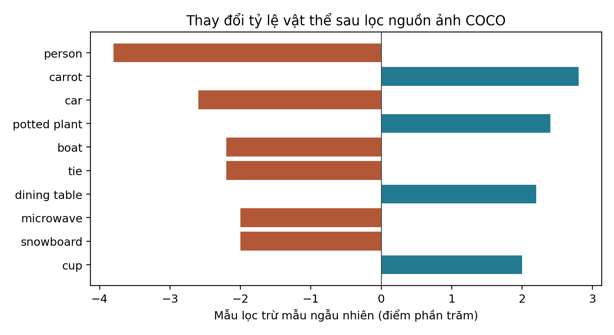

# EDA phục vụ khái quát hóa HGAI sang VLM nhỏ

**Bản 9 — ngày 06/10/2026.** COCO val2014 là dữ liệu đánh giá chính; SmolVLM2-2.2B và TinyLLaVA-3.1B là mô hình chính; LLaVA-1.5-7B là mốc kiểm chứng. CHAIR là thước đo chính, POPE kiểm tra chéo. VizWiz được rút thành bối cảnh ở phụ lục, không nhân đôi thí nghiệm HGAI.

Phạm vi nghiên cứu là COCO val2014 với hai VLM nhỏ; LLaVA-1.5-7B dùng làm mốc kiểm chứng. Thí nghiệm TinyLLaVA hiện dùng **bczhou/TinyLLaVA-3.1B, Phi-2 + SigLIP 384px**. Cần đối chiếu checkpoint này với `tinyllava/TinyLLaVA-Phi-2-SigLIP-3.1B` trong kế hoạch đóng góp trước khi gộp kết quả; hai định danh không được mặc nhiên xem là cùng trọng số.

Các mục 1–4 trình bày EDA, processor và phép nối annotation. Kết quả sinh caption thăm dò cùng trạng thái chạy được lưu trong tài liệu thí nghiệm riêng. Chưa có kết quả đầy đủ để kết luận hiệu quả HGAI.

Nhánh đánh giá chính và dev mỗi bộ 500 ảnh có **0/500 khớp các nguồn ID đã kiểm tra**: LLaVA, ShareGPT4V SFT/pretraining/cap100K và OneVision ShareGPT4V-COCO. Điều này chỉ mô tả phạm vi nguồn đã kiểm tra. Khi tắt chia ô, SmolVLM2 giảm còn 81 token và resize vuông; phép đối chứng này thay cả ngân sách token lẫn hình học.

## 1. Dữ liệu, toàn vẹn và nguồn huấn luyện

COCO val2014 có 40.504 ảnh và 202.654 caption; thống kê ngôn ngữ chọn một caption hợp lệ có annotation ID thấp nhất mỗi ảnh. CHAIR dùng mọi caption chuẩn cùng instance annotation, không dùng một caption làm nhãn ground truth. Trùng câu caption train/val không đủ để kết luận rò rỉ ảnh.

### Toàn vẹn và tổng rò rỉ LLaVA, có VG/GQA

<!-- CSV {"path": "eda_results/hgai/integrity_training_union.csv", "title": "Toàn vẹn và tổng rò rỉ LLaVA, có VG/GQA", "columns": null} -->
| Kiểm tra | COCO | Diễn giải |
| :--- | :--- | :--- |
| COCO val2014/train2017 ID | 35.504/40.504 (87,656%) | Giao nhau split; không phải bằng chứng VLM đã học mọi ảnh. |
| COCO trực tiếp trong mix665K LLaVA | 5.741/40.504 (14,174%) | Đường dẫn ảnh trong file SFT chính thức. |
| Visual Genome/GQA alias toàn bộ | 16.221/40.504 (40,048%) | Nối image_id VG/GQA với coco_id; có giao với nhóm trực tiếp. |
| Visual Genome/GQA alias-only | 10.877/40.504 (26,854%) | Chưa có đường dẫn COCO trực tiếp. |
| TỔNG COCO trực tiếp ∪ alias VG/GQA | 16.618/40.504 (41,028%) | 5.741 + 10.877; không cộng lặp 16.221. |
| Manifest eval_random500 | 205/500 (41,000%) | 70 trực tiếp + 135 alias-only; 295 chưa khớp. |
| Ảnh thiếu/rỗng/giải mã lỗi | 0/40.504 | Kiểm tra toàn bộ val đã có; ảnh VizWiz cũng 0/7.750. |
| Nhãn bbox COCO | 291.875 instance; 367 ảnh không có instance | Giữ ảnh không có instance, dùng hợp instance và mọi caption chuẩn cho CHAIR. |
<!-- /CSV -->

Số 41,028% đo trên **mix instruction tuning LLaVA**, không bao trùm pretraining của CLIP/LLM hay pixel trùng ở nguồn khác. Nguồn và hash đã lưu trong [kiểm tra VG/GQA](eda_results/vlm_extensions/llava15_vg_gqa_alias_overlap.json). Không dùng số này như tỷ lệ rò rỉ của hai VLM nhỏ.

### 1.1. Kiểm tra riêng TinyLLaVA và SmolVLM2

[Model card TinyLLaVA-3.1B](https://huggingface.co/bczhou/TinyLLaVA-3.1B) công bố hai recipe LLaVA và ShareGPT4V. Đã quét file SFT 665K LLaVA, SFT ShareGPT4V và pretraining ShareGPT4V, nối đường dẫn COCO trực tiếp và alias VG/GQA. Bảng ghi hai recipe riêng vì model card chưa xác định đầy đủ manifest huấn luyện cho riêng checkpoint; không tự coi tất cả recipe là lịch sử huấn luyện chắc chắn của checkpoint. Pretraining LAION/CC/SBU, encoder SigLIP và LLM nền vẫn ngoài phép nối ID này.

[Model card SmolVLM2](https://huggingface.co/HuggingFaceTB/SmolVLM2-2.2B-Instruct) nêu tập huấn luyện lấy mẫu từ mười nguồn, gồm OneVision, M4-Instruct và MAmmoTH-VL; mô hình cũng kế thừa SmolVLM nền. Bản này đọc riêng cột ID của hai slice OneVision ShareGPT4V để nối COCO, không tải các cột ảnh. **Khớp nguồn upstream chỉ là ảnh ứng viên có thể được chọn**, chưa chứng minh ảnh nằm trong chính 3,3 triệu mẫu dùng huấn luyện SmolVLM2. Các slice còn lại và pretraining nền chưa có full manifest để kết luận sạch.

Đã kiểm tra thêm [repository chính thức của SmolVLM2](https://github.com/huggingface/smollm/tree/main/vision/smolvlm2): script `multinode25.sh` chọn YAML mixture gồm **110 mục nguồn**, có tỷ lệ lấy mẫu riêng; ShareGPT4V-COCO và ShareGPT4V-LLaVA được ghi 100%. YAML trỏ tới các JSON nội bộ `/fsx/...`, chưa cung cấp danh sách ID được chọn cùng liên kết đầy đủ tới checkpoint này. Vì vậy đã xác minh thêm **recipe công bố**, chưa thể biến nó thành manifest huấn luyện thực tế. [Bằng chứng đã lưu](eda_results/hgai/smol_training_evidence.json), [110 mục nguồn](eda_results/hgai/smol_published_recipe.csv), [kiểm kê nguồn còn thiếu](eda_results/hgai/source_availability.json). Không suy luận rằng hai slice đã kiểm tra bao phủ toàn bộ dữ liệu SmolVLM2.

### Khớp ID theo mô hình/recipe và từng manifest

<!-- CSV {"path": "eda_results/hgai/small_vlm_training_overlap_summary.csv", "title": "Khớp ID theo mô hình/recipe và từng manifest", "columns": ["scope", "model_or_recipe", "images", "matched_ids", "matched_pct", "status"]} -->
| Phạm vi | Mô hình / recipe | Số ảnh | ID khớp | Tỷ lệ khớp (%) | Giới hạn kết luận |
| :--- | :--- | :--- | :--- | :--- | :--- |
| val2014 | LLaVA-1.5-7B | 40504 | 16618 | 41,028 | exact_SFT_manifest_ID_join |
| val2014 | TinyLLaVA/LLaVA-recipe | 40504 | 16618 | 41,028 | recipe_conditional_exact_SFT_ID_join |
| val2014 | TinyLLaVA/ShareGPT4V-recipe | 40504 | 37527 | 92,650 | recipe_conditional_pretrain_and_SFT_ID_join |
| val2014 | SmolVLM2/OneVision-ShareGPT4V-COCO | 40504 | 15056 | 37,172 | upstream_pool_candidate_not_verified_training_exposure |
| dev_common_unmatched500 | LLaVA-1.5-7B | 500 | 0 | 0 | exact_SFT_manifest_ID_join |
| dev_common_unmatched500 | TinyLLaVA/LLaVA-recipe | 500 | 0 | 0 | recipe_conditional_exact_SFT_ID_join |
| dev_common_unmatched500 | TinyLLaVA/ShareGPT4V-recipe | 500 | 0 | 0 | recipe_conditional_pretrain_and_SFT_ID_join |
| dev_common_unmatched500 | SmolVLM2/OneVision-ShareGPT4V-COCO | 500 | 0 | 0 | upstream_pool_candidate_not_verified_training_exposure |
| eval_common_unmatched500 | LLaVA-1.5-7B | 500 | 0 | 0 | exact_SFT_manifest_ID_join |
| eval_common_unmatched500 | TinyLLaVA/LLaVA-recipe | 500 | 0 | 0 | recipe_conditional_exact_SFT_ID_join |
| eval_common_unmatched500 | TinyLLaVA/ShareGPT4V-recipe | 500 | 0 | 0 | recipe_conditional_pretrain_and_SFT_ID_join |
| eval_common_unmatched500 | SmolVLM2/OneVision-ShareGPT4V-COCO | 500 | 0 | 0 | upstream_pool_candidate_not_verified_training_exposure |
| eval_random500 | LLaVA-1.5-7B | 500 | 205 | 41 | exact_SFT_manifest_ID_join |
| eval_random500 | TinyLLaVA/LLaVA-recipe | 500 | 205 | 41 | recipe_conditional_exact_SFT_ID_join |
| eval_random500 | TinyLLaVA/ShareGPT4V-recipe | 500 | 460 | 92 | recipe_conditional_pretrain_and_SFT_ID_join |
| eval_random500 | SmolVLM2/OneVision-ShareGPT4V-COCO | 500 | 171 | 34,200 | upstream_pool_candidate_not_verified_training_exposure |
<!-- /CSV -->

Phạm vi OneVision đã đọc: **8/8 shard ID** của `sharegpt4v(coco)` (6 shard) và `sharegpt4v(llava)` (2 shard); tổng 80,007 dòng metadata. Xem [provenance](eda_results/hgai/onevision_id_provenance.json), [cờ từng ảnh](eda_results/hgai/small_vlm_training_overlap.csv) và [phạm vi kiểm tra](eda_results/hgai/small_vlm_training_overlap.json). Không gán giá trị 0 cho nguồn chưa kiểm tra.

## 2. Manifest dev/eval cố định và vai trò từng bộ

Tập **2.977 ảnh** chưa khớp hợp nguồn đã kiểm tra đúng bằng phần bù **theo từng ID** của 37.527 ảnh thuộc ShareGPT4V-recipe trong COCO val2014 (đã so cờ trên toàn bộ 40.504 ảnh). Chưa xác minh giả thuyết đây chính là các ảnh COCO val2017 không có trong Visual Genome. Từ pool này chọn **eval_common_unmatched500** (seed45) và **dev_common_unmatched500** (seed46), mỗi bộ 500 ảnh, không trùng ID/MD5.

**eval_random500** (seed42) là nhánh mẫu ngẫu nhiên dùng đối chiếu giao thức bài báo. Ba bộ đang dùng là dev_common_unmatched500, eval_common_unmatched500 và eval_random500; điểm của mẫu lọc và mẫu ngẫu nhiên được báo riêng.

Mỗi bộ có đúng 500 ảnh, JSONL kèm mọi caption và CSV có ID/đường dẫn/cờ nguồn. [Khóa bản 8](data_prepared/hgai/manifest_lock.json) được giữ nguyên byte; [khóa hai bộ mới bản 9](data_prepared/hgai/manifest_lock_common_v9.json) lưu SHA-256 nguồn và từng JSONL. Việc chọn hai bộ mới diễn ra trước khi có output mô hình. Chạy lại kiểm tra khóa; không âm thầm rút ảnh mới sau khi có output. Mọi mô hình và điều kiện trong một nhánh dùng cùng danh sách ảnh.

### Kích thước và cờ nguồn LLaVA của các bộ cố định

<!-- CSV {"path": "eda_results/hgai/manifest_summary.csv", "title": "Kích thước và cờ nguồn LLaVA của các bộ cố định", "columns": ["partition", "images", "seed", "direct_coco", "vg_gqa_alias", "known_union", "unmatched"]} -->
| Bộ ảnh | Số ảnh | Seed | COCO trực tiếp | VG/GQA | Khớp hợp nguồn | Chưa khớp |
| :--- | :--- | :--- | :--- | :--- | :--- | :--- |
| eval_random500 | 500 | 42 | 70 | 201 | 205 | 295 |
| eval_common_unmatched500 | 500 | 45 | 0 | 0 | 0 | 500 |
| dev_common_unmatched500 | 500 | 46 | 0 | 0 | 0 | 500 |
<!-- /CSV -->

Các bộ common-unmatched chỉ loại các nguồn đã kiểm tra, còn những nguồn SmolVLM2 khác chưa được xác minh. Lọc ảnh thay đổi phân bố đánh giá; báo nhánh lọc và random riêng, không chọn nhánh có điểm tốt hơn. Đã tính chênh lệch hình học/token và phân bố 80 lớp object giữa hai nhánh, thay vì coi mẫu lọc tương đương ngẫu nhiên. [Bảng object theo ảnh](eda_results/hgai/sampling_object_distribution.csv).

Trong 500 ảnh eval, tỷ lệ có `person` giảm từ 54,2% ở mẫu ngẫu nhiên xuống 50,4% ở mẫu lọc (−3,8 điểm phần trăm), `car` giảm từ 11,0% xuống 8,4% (−2,6 điểm), còn `carrot` tăng 2,8 điểm. Đây là thay đổi có thể ảnh hưởng CHAIR và cần hiện diện cùng bảng điểm.

### Kiểm tra thay đổi phân bố sau khi lọc nguồn huấn luyện

<!-- CSV {"path": "eda_results/hgai/sampling_geometry_shift.csv", "title": "Kiểm tra thay đổi phân bố sau khi lọc nguồn huấn luyện", "columns": null} -->
| Bộ ảnh | Số ảnh | portrait_pct | square_pct | mean_tiny_pad_pct | mean_smol_image_tokens_split_on | median_reference_caption_tokens_smol | median_largest_object_center_offset | images_without_instances |
| :--- | :--- | :--- | :--- | :--- | :--- | :--- | :--- | :--- |
| eval_random500 | 500 | 24 | 4 | 28,428 | 1086,696 | 12 | 0,245 | 8 |
| eval_unmatched500 | 500 | 27 | 3,800 | 27,664 | 1093,176 | 11 | 0,241 | 8 |
| dev500 | 500 | 24 | 4 | 28,159 | 1091,232 | 11 | 0,261 | 4 |
| eval_common_unmatched500 | 500 | 24,200 | 2,800 | 28,796 | 1080,216 | 11 | 0,237 | 5 |
| dev_common_unmatched500 | 500 | 25,800 | 4,800 | 27,655 | 1091,232 | 12 | 0,243 | 5 |
<!-- /CSV -->

Tác giả HGAI dùng seed927 và `random.shuffle(os.listdir(...))`; thứ tự file trước shuffle phụ thuộc máy. Khi chưa có manifest ảnh gốc của tác giả, bộ seed42 chỉ có thể **khớp giao thức và kiểu lấy mẫu**, chưa tái lập chính xác các ID hoặc đảm bảo ra lại đúng 53,0.

## 3. Tiền xử lý thật và số visual token

Processor đã được đo trên ba manifest đang dùng, mỗi bộ 500 ảnh. SmolVLM2 được đo khi bật và tắt chia ô; TinyLLaVA dùng pad384. Phép đo chỉ nạp processor/tokenizer. Môi trường CPU là Transformers 4.53.3; [cấu hình và phiên bản](eda_results/hgai/processor_environment.json) được lưu cùng revision nguồn.

### 3.1. SmolVLM2: đếm placeholder ảnh sau processor

Processor checkpoint có `size.longest_edge=1536`, `max_image_size.longest_edge=384`, `image_seq_len=81`. Đếm ID `<image>` trong `input_ids` đã mở rộng, kiểm tra bằng số tile trong `pixel_values` × 81. Không cộng token hàng/cột, token biên, prompt hay frame video vào số visual token. Không dùng số patch encoder 729 thay cho 81 token nén đưa vào LLM.

### Phân bố token ảnh SmolVLM2 khi bật chia ô

<!-- CSV {"path": "eda_results/hgai/image_token_summary.csv", "title": "Phân bố token ảnh SmolVLM2 khi bật chia ô", "columns": ["partition", "model", "mode", "n", "mean", "p50", "p90", "p95", "p99", "min", "max"]} -->
| Bộ ảnh | Mô hình | Chế độ | Số ảnh | Trung bình | P50 | P90 | P95 | P99 | Nhỏ nhất | Lớn nhất |
| :--- | :--- | :--- | :--- | :--- | :--- | :--- | :--- | :--- | :--- | :--- |
| dev_common_unmatched500 | SmolVLM2-2.2B | split_on | 500 | 1091,232 | 1053 | 1377 | 1377 | 1377 | 729 | 1377 |
| eval_common_unmatched500 | SmolVLM2-2.2B | split_on | 500 | 1080,216 | 1053 | 1377 | 1377 | 1377 | 405 | 1377 |
| eval_random500 | SmolVLM2-2.2B | split_on | 500 | 1086,696 | 1053 | 1377 | 1377 | 1377 | 729 | 1377 |
<!-- /CSV -->

Bật chia ô giữ các tile cục bộ và một ảnh global; 640×480 cho **13 × 81 = 1.053 token**, 640×640 cho **17 × 81 = 1.377 token**. Tắt chia ô cho **81 token** ở mọi ảnh; TinyLLaVA pad384 luôn cho **729 patch token**. Hai giá trị hằng không cần lặp lại trong bảng.

Hai bộ dev hiện hành và cũ có cùng trung bình 1.091,232 token vì cùng histogram đo được: 5 ảnh có 729, 431 ảnh có 1.053 và 64 ảnh có 1.377 token. Danh sách ID không giao nhau và chuỗi token theo thứ tự ảnh khác nhau; đây không phải dòng bị sao chép.

### 3.2. Pad, crop, thu nhỏ và méo hình

TinyLLaVA-3.1B dùng pad vuông trước SigLIP 384px, 27×27 = **729 patch token**, không có CLS. Đã đối chiếu tensor processor Hugging Face với lớp `SigLipImageProcessor` ở mã legacy TinyLLaVA trên 20 ảnh cố định; [kết quả tương đương](eda_results/hgai/tiny_processor_equivalence.json) nêu sai lệch tối đa. Tương đương processor không chứng minh output model giống nhau khi chưa chạy forward.

SmolVLM2 **không luôn giữ nguyên tỷ lệ khung hình**: khi chia ô, processor làm tròn hai cạnh lên bội số 384 rồi tạo tile vuông; ảnh global bị resize vuông. Khi tắt chia ô, ảnh bị resize thẳng về 384×384. `do_pad=True` ở đây chủ yếu phục vụ tensor/batch, không đồng nghĩa với letterbox của TinyLLaVA. Báo độ méo tile và độ méo global riêng. Diện tích crop bằng 0 nghĩa là hợp mọi tile còn phủ ảnh, không phải từng tile nhìn thấy toàn ảnh.

### Hình học processor trên từng dev/eval

<!-- CSV {"path": "eda_results/hgai/processor_geometry_summary.csv", "title": "Hình học processor trên từng dev/eval", "columns": ["partition", "model", "mode", "n", "mean_padding_pct", "crop_area_lost_pct", "median_distortion", "max_distortion", "median_global_distortion", "median_local_source_per_pixel"]} -->
| Bộ ảnh | Mô hình | Chế độ | Số ảnh | Đệm trung bình (%) | Diện tích cắt (%) | Méo trung vị | Méo lớn nhất | Méo ảnh toàn cảnh | Pixel nguồn / pixel tile |
| :--- | :--- | :--- | :--- | :--- | :--- | :--- | :--- | :--- | :--- |
| dev_common_unmatched500 | SmolVLM2-2.2B | split_off | 500 | 0 | 0 | 1,337 | 3,536 | 1,337 | — |
| dev_common_unmatched500 | SmolVLM2-2.2B | split_on | 500 | 0 | 0 | 1,084 | 1,768 | 1,337 | 0,417 |
| dev_common_unmatched500 | TinyLLaVA-3.1B | pad_384 | 500 | 27,655 | 0 | 1 | 1 | 1 | — |
| eval_common_unmatched500 | SmolVLM2-2.2B | split_off | 500 | 0 | 0 | 1,397 | 4,025 | 1,397 | — |
| eval_common_unmatched500 | SmolVLM2-2.2B | split_on | 500 | 0 | 0 | 1,116 | 1,479 | 1,397 | 0,417 |
| eval_common_unmatched500 | TinyLLaVA-3.1B | pad_384 | 500 | 28,796 | 0 | 1 | 1 | 1 | — |
| eval_random500 | SmolVLM2-2.2B | split_off | 500 | 0 | 0 | 1,400 | 2,379 | 1,400 | — |
| eval_random500 | SmolVLM2-2.2B | split_on | 500 | 0 | 0 | 1,121 | 1,486 | 1,400 | 0,417 |
| eval_random500 | TinyLLaVA-3.1B | pad_384 | 500 | 28,428 | 0 | 1 | 1 | 1 | — |
<!-- /CSV -->

Hệ số méo = tỷ số giữa hệ số scale hai trục, lấy giá trị ≥1; 1 là giữ tỷ lệ. Tỷ số pixel nguồn/pixel mô hình >1 là thu nhỏ và <1 là phóng lớn. Với SmolVLM2, tỷ số cục bộ dùng canvas tile còn tỷ số global dùng 384px; không đồng nhất ngân sách tile với độ thu nhỏ toàn ảnh.

`crop_area_lost_pct` đo phép crop của processor. Với đầu vào 384px, patch convolution 14px ở mode valid có 27 patch mỗi trục, phủ 378px; 6px cuối bên phải/dưới không thuộc patch (khoảng 3,10% diện tích tensor danh nghĩa). Vì vậy “processor không crop” không đồng nghĩa encoder sử dụng mọi pixel; không cộng tỷ lệ này như một phép center crop trên ảnh nguồn.

Với phép center crop vuông lý tưởng trước CLIP 336px trên COCO val2014, **12,20% bbox nằm hoàn toàn ngoài vùng cắt**, **18,63% có tâm nằm ngoài**, và **37,71% bị cắt ít nhất một phần** (291.874 bbox có diện tích dương). Đây là tỷ lệ trên bbox, không phải tỷ lệ ảnh; [phép đếm](eda_results/hgai/coco_center_crop_object_coverage.json) đo rủi ro trực tiếp cho nhánh cắt giữa.

Đã bổ sung đối chứng hình học **toàn bộ val** ở TinyLLaVA 384px (pad, center crop, resize vuông) và LLaVA 336px (crop theo mã HGAI, pad). Đây là phép tính hình học trên kích thước đã áp EXIF, không phải chạy processor/model trên toàn val.

### Đối chứng hình học toàn val, phân biệt cấu hình thật và control

<!-- CSV {"path": "eda_results/hgai/fixed_mode_geometry_summary.csv", "title": "Đối chứng hình học toàn val, phân biệt cấu hình thật và control", "columns": null} -->
| dataset | Mô hình | Chế độ | Số ảnh | median_pad_pct | median_crop_pct | Méo trung vị | median_long_edge_source_per_target |
| :--- | :--- | :--- | :--- | :--- | :--- | :--- | :--- |
| COCO | LLaVA-1.5-7B | hgai_center_crop | 40504 | 0 | 26,719 | 1 | 1,905 |
| COCO | LLaVA-1.5-7B | pad_control | 40504 | 26,719 | 0 | 1 | 1,905 |
| COCO | TinyLLaVA-3.1B | center_crop_control | 40504 | 0 | 26,719 | 1 | 1,667 |
| COCO | TinyLLaVA-3.1B | direct_square_control | 40504 | 0 | 0 | 1,365 | 1,667 |
| COCO | TinyLLaVA-3.1B | pad | 40504 | 26,719 | 0 | 1 | 1,667 |
| VizWiz | LLaVA-1.5-7B | hgai_center_crop | 7750 | 0 | 25 | 1 | 3,857 |
| VizWiz | LLaVA-1.5-7B | pad_control | 7750 | 25 | 0 | 1 | 3,857 |
| VizWiz | TinyLLaVA-3.1B | center_crop_control | 7750 | 0 | 25 | 1 | 3,375 |
| VizWiz | TinyLLaVA-3.1B | direct_square_control | 7750 | 0 | 0 | 1,333 | 3,375 |
| VizWiz | TinyLLaVA-3.1B | pad | 7750 | 25 | 0 | 1 | 3,375 |
<!-- /CSV -->

### 3.3. Lệch tâm vật thể đã được đo

Với bbox COCO, độ lệch tâm = khoảng cách Euclid từ tâm bbox đến tâm ảnh / nửa đường chéo ảnh. Tính cho từng instance và xuất theo ảnh: trung bình các bbox, bbox có diện tích annotation lớn nhất và trung bình có trọng số diện tích. Crowd được giữ và có số đếm riêng; không có bbox thì để trống, không gán lệch tâm 0.

Trên **40,137 ảnh có instance**, độ lệch tâm object lớn nhất có p50/p90/p95/p99 = **0.244/0.539/0.618/0.743**; 367 ảnh không có instance. [Bảng từng ảnh](eda_results/hgai/coco_object_centering.csv). VizWiz chưa có bbox ground truth, nên không có phép đo lệch tâm vật thể tương đương. Pilot chưa đủ để kiểm định tương quan lỗi CHAIR/POPE với lệch tâm.

## 4. Tokenizer, đối tượng và nhãn CHAIR

Đếm caption bằng **tokenizer đúng checkpoint**, `add_special_tokens=False`, không truncation, một caption hợp lệ có annotation ID thấp nhất mỗi ảnh. Token prompt/template, visual token và output model không nằm trong bảng này. COCO có 40.504 caption được chọn; VizWiz ở phần bối cảnh có 7.542, loại 208 ảnh không còn caption hợp lệ.

### Độ dài caption theo tokenizer hai mô hình chính

<!-- CSV {"path": "eda_results/hgai/caption_token_summary.csv", "title": "Độ dài caption theo tokenizer hai mô hình chính", "columns": null} -->
| dataset | Mô hình | Số ảnh | Trung bình | Nhỏ nhất | P50 | P90 | P95 | P99 | Lớn nhất |
| :--- | :--- | :--- | :--- | :--- | :--- | :--- | :--- | :--- | :--- |
| COCO | SmolVLM2-2.2B | 40504 | 11,947 | 7 | 11 | 15 | 17 | 21 | 53 |
| COCO | TinyLLaVA-3.1B | 40504 | 11,982 | 7 | 12 | 15 | 17 | 21 | 52 |
| VizWiz-context | SmolVLM2-2.2B | 7542 | 13,472 | 7 | 12 | 19 | 22 | 32 | 80 |
| VizWiz-context | TinyLLaVA-3.1B | 7542 | 13,358 | 7 | 12 | 18 | 22 | 31 | 76 |
<!-- /CSV -->

12 siêu danh mục COCO được đặt ngay **dưới đoạn giới thiệu này**, theo số object instance; không trộn đơn vị này với tần suất nhắc object trong caption.

### 12 siêu danh mục COCO val2014

<!-- CSV {"path": "eda_results/hgai/coco_supercategories.csv", "title": "12 siêu danh mục COCO val2014", "columns": null} -->
| Supercategory | Count | Percentage |
| :--- | :--- | :--- |
| person | 88153 | 30,200 |
| vehicle | 32574 | 11,160 |
| kitchen | 29445 | 10,090 |
| furniture | 26296 | 9,010 |
| animal | 21806 | 7,470 |
| food | 21423 | 7,340 |
| sports | 16786 | 5,750 |
| indoor | 15795 | 5,410 |
| accessory | 15483 | 5,300 |
| electronic | 9822 | 3,370 |
| outdoor | 9710 | 3,330 |
| appliance | 4582 | 1,570 |
<!-- /CSV -->

### 4.1. Một định nghĩa nhóm từ chỉ người

Bảng nhóm từ chỉ người và Hình 4 dùng chung **đồng nghĩa CHAIR, ưu tiên cụm dài**, cùng caption đã chọn, không lọc POS riêng. Bảng cũ dùng năm danh từ hẹp đã được thay và mã tạo bảng cũng cập nhật để chạy lại không sinh số cũ. `person` trong annotation chiếm 30,20% số instance là một đại lượng khác.

### Nhóm người thống nhất với ontology CHAIR

<!-- CSV {"path": "eda_results/tables/person_reference_one_caption_per_image.csv", "title": "Nhóm người thống nhất với ontology CHAIR", "columns": ["Dataset", "All Images", "Selected Captions", "Person-family Mentions", "Selected Captions with Person Family", "Selected Captions with Person Family (%)", "Matching Rule"]} -->
| Dataset | All Images | Selected Captions | Person-family Mentions | Selected Captions with Person Family | Selected Captions with Person Family (%) | Matching Rule |
| :--- | :--- | :--- | :--- | :--- | :--- | :--- |
| MS-COCO val2014 | 40504 | 40504 | 16557 | 15196 | 37,520 | CHAIR person synonyms; longest phrase first; lexical, no POS filter |
| VizWiz val | 7750 | 7542 | 678 | 653 | 8,660 | CHAIR person synonyms; longest phrase first; lexical, no POS filter |
<!-- /CSV -->

### 4.2. Không dùng caption đơn làm ground truth

CHAIR chính thức dùng hợp nhãn instance và đối tượng từ mọi caption chuẩn, với quy tắc chuẩn hóa của evaluator. Đối chiếu lexical trong EDA chỉ chẩn đoán độ phủ, không thay evaluator CHAIR. Cần pin evaluator và annotation nguồn trước khi chạy baseline/HGAI, lưu numerator/denominator cho CHAIR-S và CHAIR-I, cùng recall/F1 để tránh giảm hallucination bằng cách không nhắc object.

Độ phủ lexical đã đo: một caption thu hồi **38.07%** lớp instance, hợp mọi caption thu hồi **55.26%**. [Kiểm tra độ đầy đủ nhãn](eda_results/vlm_extensions/coco_caption_label_completeness.json). Không ép mọi ảnh có đúng năm caption vì annotation COCO có số lượng caption biến thiên.

## 5. Giao thức HGAI và thiết kế thí nghiệm

### 5.1. Mốc LLaVA-1.5-7B phải chạy trước

[Mã đánh giá của tác giả](https://github.com/ZhangqiJiang07/middle_layers_indicating_hallucinations/blob/main/chair_eval.py) dùng **“Please help me describe the image in detail.”**, 500 ảnh COCO, `max_new_tokens=512`, `do_sample=False`, `num_beams=1`, HGAI mean aggregation, α=0,5, layer **5–18 inclusive**. Bản source và commit được lưu trong `eda_resources/hgai_original/`.

Bảng 2 và 3 của bài báo HGAI v3 ghi CHAIR-S greedy LLaVA **53,0 ở 512 token** và **23,8 ở 64 token**; đây là số công bố, không phải kết quả ở workspace. [Bảng 2](https://arxiv.org/html/2411.16724v3#S4.T2), [bảng 3](https://arxiv.org/html/2411.16724v3#S4.T3). Con số 20,8 trong nội dung đối chiếu người dùng gửi chưa khớp nguồn gốc; bản v1 cũng ghi 23,8. Độ dài ngắn thu hẹp phần lỗi có thể giảm (headroom), nên 64 token không còn là giao thức chính.

Mã `eval_data_loader.py` gọi processor trực tiếp; với CLIP 336px đây là resize/crop. Nhánh kiểm chứng giới hạn ở baseline và HGAI layer 5–18, α=0,5 trên mẫu ngẫu nhiên. Kết quả NF4 phải được ghi riêng với hàng FP16 công bố. Cần chạy cặp FP16–NF4 trên cùng vài chục ảnh, cùng checkpoint/processor/decoding, ở GPU đủ bộ nhớ; báo chênh lệch CHAIR ghép cặp trước khi diễn giải độ lệch so với 53,0.

### 5.2. Tách ảnh hưởng độ dài khỏi ảnh hưởng prompt

| Điều kiện | Prompt | Token tối đa | Vai trò |
| :--- | :--- | ---: | :--- |
| detailed512 | Prompt mô tả chi tiết HGAI | 512 | Giao thức chính |
| detailed64 | Cùng prompt chi tiết | 64 | Chỉ thay giới hạn độ dài |
| concise64 | Prompt một câu và cho phép từ chối | 64 | Điều kiện phụ thay prompt và từ chối |

Mỗi so sánh baseline–HGAI phải giữ cùng manifest, processor, template đúng mô hình, prompt, seed và decoding. Không lấy chênh lệch `detailed512`/`concise64` làm riêng hiệu ứng α. Script `llava_pilot.py` mặc định dùng dev_common_unmatched500, detailed512 và đường crop theo mã HGAI; hỗ trợ ba điều kiện và cả pad control, lưu cấu hình và SHA manifest, từ chối ghi đè output đã có. Script chỉ chạy baseline LLaVA; không tự nhận là adapter HGAI cho Phi-2/SmolLM2.

### 5.3. Layer và α của VLM nhỏ

Tuning dùng **dev_common_unmatched500**. Trước hết đo đường cong VAR và độ nhạy khi che ảnh theo từng layer trên dev, công bố tiêu chí xác định hai ranh giới từ đường cong rồi mới chọn dải can thiệp. So dải đã chọn với phân phối dải ngẫu nhiên cùng độ rộng, quét oracle trên dev và điều kiện can thiệp **mọi layer**. Không dùng eval hoặc POPE để đặt ranh giới hay chọn α. Ba dải cố định theo tỷ lệ chiều sâu chỉ có thể là phân tích phụ, không phải phương pháp chọn layer chính.

Kiểm chứng SmolVLM2 trên hai ảnh cho thấy α=0,5 làm độ dài caption trung bình giảm từ 298 xuống 10,5 token và object F1 về 0. Phép dò chỉ đo độ dài output trên cùng 10 ảnh dev: α=0,02/0,035/0,05 đều có **0/10 ảnh** mất quá nửa độ dài so với baseline; ở 0,075 là **1/10**, ở 0,10 là **3/10**. Lưới Smol cho dev500 được khóa ở **{0,02; 0,035; 0,05}**, kèm baseline α=0. [Kết quả ghép ảnh](experiment_outputs/alpha_dose_probe/paired_length_analysis.json) và [khóa lưới](eda_results/hgai/smol_alpha_grid_lock.json) chỉ dựa vào độ dài; CHAIR, recall/F1 và guard trên dev500 mới quyết định cấu hình cuối. TinyLLaVA cần phép dò riêng sau khi thống nhất checkpoint.

HGAI gốc cộng α × trung bình liên head của trị tuyệt đối attention **logit** vào các vị trí ảnh trước softmax. Số vị trí ảnh thay đổi làm đổi số phần tử bị can thiệp và phép chuẩn hóa softmax. Đối chứng SmolVLM2 cần ba mức token ảnh: chia ô mặc định, chia ô với `size.longest_edge=768`, và tắt chia ô. Processor cho **405 token** với ảnh 640×480 ở mức giữa; cần đo phân bố trên toàn manifest trước khi chạy. Mức giữa giữ cơ chế chia ô; nhánh tắt chia ô đồng thời thay hình học. Ảnh COCO có thể được phóng lớn khoảng 2,4 lần khi chia ô, nên số token tăng không đồng nghĩa thông tin ảnh tăng. Nhận diện đúng các vị trí `<image>` sau processor và loại token grid/biên.

CHAIR-S/I cần đi cùng object recall/F1, số output token thật, tỷ lệ chạm giới hạn, tỷ lệ từ chối, repetition/Distinct-1, thời gian và bộ nhớ. Ước lượng CI bằng bootstrap **ghép cặp theo ảnh** cho baseline–HGAI; giữ toàn bộ lỗi trên cùng ảnh trong một mẫu bootstrap. Chọn thông số xong phải lưu cấu hình rồi mới chạy eval.

### 5.4. POPE là benchmark kiểm tra chéo riêng

Dùng các bộ COCO random/popular/adversarial chính thức, giữ nhãn và negative sampling gốc. Không coi 500 ảnh CHAIR là một POPE mới hoặc ép POPE trùng manifest rồi so với số công bố. Báo accuracy, precision, recall, F1 và yes-rate, kèm số câu hỏi/ảnh, nguồn và hash. Nếu phân tích thêm các ảnh giao với eval500 thì ghi rõ đó là subset, không thay điểm POPE chính thức.

[Cấu hình thí nghiệm máy đọc được](eda_results/hgai/experiment_config.json) ghi các điều kiện trên. Adapter HGAI đã được kiểm tra công thức, GQA, mask/cache và α=0 trên CPU, rồi chạy với trọng số Smol thật. Lưới α cũ đã dừng trước tuning; kết quả đầy đủ cho hai VLM nhỏ và hàng kiểm chứng LLaVA còn chờ thực thi theo kế hoạch cập nhật. [Hướng dẫn thực thi](HGAI_Experiments.md).

Các lệnh chạy, pilot và tiến độ được ghi trong [nhật ký thực thi](HGAI_Run_Log.md).

## Phụ lục A. VizWiz: bối cảnh và kiểm tra EXIF

VizWiz không nằm trong benchmark HGAI chính hiện tại. Vai trò của nó là minh họa domain gap/giới hạn ontology: 7.750 ảnh val; 99,23% ảnh dọc sau EXIF; 64,75% có chữ theo đa số annotator; 9,69% có ≥3/5 caption từ chối. Median Laplacian toàn val sau resize cạnh ngắn 480px là 152,16, so với 1.140,08 ở COCO; đây là năng lượng biên/texture, không tự chứng minh nguyên nhân blur hay hiệu quả HGAI.

Có 493 ảnh có EXIF xoay, 845 ảnh có nhãn Rotated đa số, giao 199. Nhóm **646/7.750 (8,335%)** có nhãn Rotated nhưng không có thẻ EXIF xoay: EXIF không biến đổi pixel nhóm này. Đây là nhóm nguy cơ còn lại, **không phải số ảnh lỗi sau EXIF đã được gán nhãn lại**; không suy rằng toàn bộ 199 ảnh giao đã được sửa hoàn toàn.

Đã xem 40 cặp raw/sau EXIF, seed42, 20 ảnh ở mỗi nhóm và giữ trường hợp không rõ. Nhóm có EXIF: 17 ảnh hướng upright, 1 upright nhưng còn tilt, 2 chưa đủ chắc hướng; nhóm không EXIF: 18 sideways/upside-down, 1 nhãn vật thể quay ngang, 1 upright nhưng có tilt. Mẫu có phân tầng theo filename/ID và có thể chứa ảnh trùng byte, chỉ dùng kiểm tra pipeline; không ngoại suy thành tỷ lệ lỗi toàn bộ 199 hoặc 646 ảnh. [Worklist đã rà](eda_results/hgai/vizwiz_rotation_review40.csv), [thiết kế lấy mẫu](eda_results/hgai/vizwiz_rotation_review_sampling.json) và bốn contact sheet lưu cùng thư mục. Pipeline vẫn chốt EXIF; không tự xoay thêm ảnh từ nhãn Rotated vì nhãn này không cung cấp hướng/độ xoay.

Hình 4 giữ **20 lớp** được nhắc nhiều nhất trong caption VizWiz, cùng đơn vị một caption/ảnh; bảng đủ 80 lớp nằm ở CSV. `laptop` phần lớn đến từ từ `computer` (588/879), `dining table` từ `table` (633/794). Đây là quy tắc đồng nghĩa CHAIR, không phải ground truth object của VizWiz; phần mở rộng VizWiz nếu có sau này cần nhãn object và negative probes phù hợp.

Hình 8 và 9 chỉ chèn một lần ở phụ lục, sau nội dung giải thích; notebook nhúng ảnh vào attachment để xuất độc lập.

Toàn bộ phân tích COCO–VizWiz cũ được giữ ở [tài liệu bối cảnh](EDA_COCO_vs_VizWiz_Context.md) cùng các CSV/hình gốc; không còn chiếm một nửa nội dung chính hoặc quy định dev/giao thức HGAI. [Bảng từ gốc của Hình 4](eda_results/tables/coco80_source_terms.csv).

## Tài liệu nguồn

1. [HGAI: Devils in Middle Layers, bài báo](https://arxiv.org/abs/2411.16724); [mã chính thức](https://github.com/ZhangqiJiang07/middle_layers_indicating_hallucinations).
2. [SmolVLM2-2.2B-Instruct: model card, processor và dữ liệu huấn luyện](https://huggingface.co/HuggingFaceTB/SmolVLM2-2.2B-Instruct).
3. [TinyLLaVA-3.1B: checkpoint và hai recipe](https://huggingface.co/bczhou/TinyLLaVA-3.1B); [bài báo TinyLLaVA](https://arxiv.org/abs/2402.14289).
4. [ShareGPT4V annotation](https://huggingface.co/datasets/Lin-Chen/ShareGPT4V); [OneVision upstream](https://huggingface.co/datasets/lmms-lab/LLaVA-OneVision-Data).
5. [CHAIR gốc](https://aclanthology.org/D18-1437/); [POPE chính thức](https://github.com/RUCAIBox/POPE).
6. [COCO](https://cocodataset.org/); [VizWiz-QualityIssues](https://vizwiz.org/tasks-and-datasets/image-quality-issues/).
