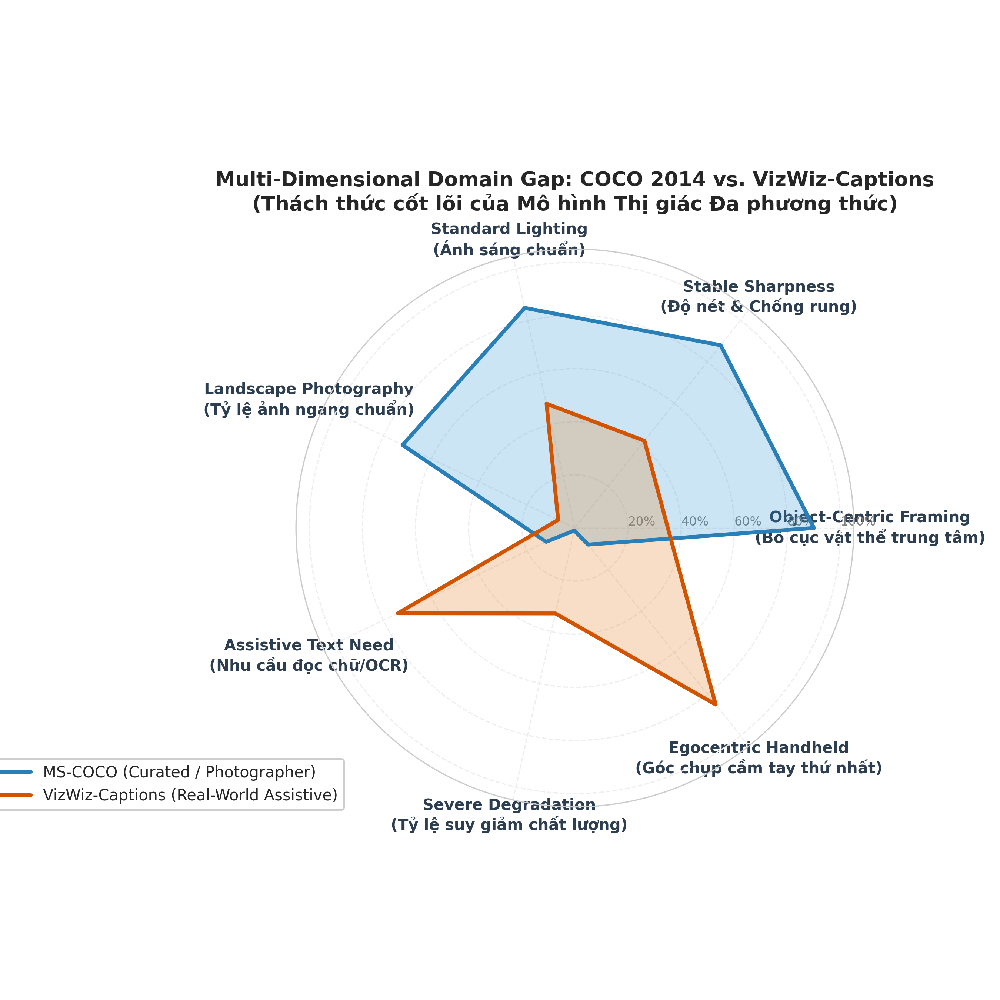

# 🔬 EDA: MS-COCO vs VizWiz-Captions
### Nghiên cứu Chuyên sâu về Domain Gap trong Trợ lý Thị giác Hỗ trợ Người Khiếm thị
*Đề tài Khóa Luận Tốt Nghiệp — Image Captioning & Multimodal Vision-Language Models*

---

## 📌 Tổng Quan Dự Án

Kho lưu trữ này chứa toàn bộ mã nguồn phân tích khám phá dữ liệu (EDA), biểu đồ trực quan hóa độ phân giải cao, bảng số liệu thống kê chi tiết và file báo cáo Jupyter Notebook đối sánh giữa hai tập dữ liệu thị giác lớn:
- **MS-COCO 2014 (Benchmark Chuẩn mực):** Đại diện cho ảnh chụp đời sống hàng ngày với bố cục chuyên nghiệp, cân đối và chất lượng cao từ Flickr.
- **VizWiz-Captions (Thực tế Hỗ trợ Đời thực):** Tập dữ liệu chụp từ góc nhìn thứ nhất (egocentric) của người khiếm thị qua điện thoại thông minh, phục vụ việc giải quyết các câu hỏi thường nhật.

---

## 🎯 6 Phát Hiện Định Lượng Cốt Lõi

1. **Đảo ngược Tỷ lệ Khung hình (Aspect Ratio Inversion):**
   - COCO chiếm **71.71% ảnh ngang (Landscape)**.
   - VizWiz có tới **92.86% ảnh dọc (Portrait)** do người khiếm thị cầm smartphone thẳng đứng khi chụp.
2. **Độ phân giải & Cảm biến:**
   - COCO chuẩn hóa cố định trung bình $576.5 \times 485.1\text{px}$ (0.28 MP).
   - VizWiz giữ nguyên cảm biến camera di động với trung bình $1067.7 \times 1339.2\text{px}$ (1.57 MP), dao động từ $23\text{px}$ đến $3264\text{px}$.
3. **Độ sắc nét Quang học & Rung mờ (Blur):**
   - Phép đo phương sai Laplacian ($\text{Var}(\nabla^2 I)$) của COCO đạt **1082.07**, trong khi VizWiz chỉ đạt **399.99** (kém gần 3 lần), phản ánh hiện tượng rung tay (motion blur) và lệch tiêu cự (defocus blur).
4. **Tỷ lệ Ảnh Suy giảm Chất lượng (Degradation):**
   - **32.62%** số ảnh trong VizWiz Val có ít nhất một annotator báo lỗi không thể nhận diện được; **2.48%** số ảnh bị hỏng hoàn toàn (100% annotators đều xác nhận không thể nhận diện).
5. **Nhu cầu Nhận diện Chữ viết (Scene Text / OCR Relevance):**
   - **73.72%** số ảnh VizWiz có chứa chữ viết (nhãn thuốc, bao bì, hạn dùng, màn hình vi tính).
6. **Lệch pha Ngữ nghĩa (Semantic Shift):**
   - COCO tập trung vào con người (`person` chiếm **30.20%**) và thể thao ngoài trời.
   - VizWiz tập trung vào đồ gia dụng, nhãn hàng, thuốc men, bao bì và màn hình vi tính (`screen`, `bottle`, `box`, `can`, `package`, `hand`, `label`, `medicine`).

---

## 📂 Cấu Trúc Thư Mục

```bash
├── EDA_COCO_vs_VizWiz_Report.ipynb    # Báo cáo Jupyter Notebook hoàn chỉnh (nhúng sẵn hình ảnh & bảng biểu)
├── EDA_COCO_vs_VizWiz_Report.md       # Báo cáo Markdown chi tiết phục vụ khóa luận tốt nghiệp
├── eda_coco_vs_vizwiz.py             # Script Python tính toán và kết xuất toàn bộ số liệu & biểu đồ
├── build_eda_notebook.py              # Script tự động đóng gói toàn bộ dữ liệu vào file Notebook
├── eda_results/
│   ├── figures/                       # 7 biểu đồ phân tích độ phân giải cao (300 DPI)
│   │   ├── 01_dataset_splits_comparison.png
│   │   ├── 02_resolution_aspect_ratio.png
│   │   ├── 03_caption_length_and_tokens.png
│   │   ├── 04_coco_category_distribution.png
│   │   ├── 05_vizwiz_quality_and_text_issues.png
│   │   ├── 06_domain_gap_characteristics.png
│   │   └── 07_qualitative_samples_grid.png
│   ├── tables/                        # 6 bảng số liệu CSV
│   │   ├── dataset_overview.csv
│   │   ├── resolution_aspect_ratio.csv
│   │   ├── caption_stats.csv
│   │   ├── coco_supercategories.csv
│   │   ├── coco_categories.csv
│   │   └── vizwiz_quality_breakdown.csv
│   └── eda_summary_metrics.json       # Tổng hợp toàn bộ chỉ số định lượng dưới dạng JSON
└── README.md
```

---

## 🚀 Hướng Dẫn Tái Lập (Reproducibility)

### 1. Cài đặt Môi trường
```bash
pip install pandas numpy matplotlib seaborn pillow
```

### 2. Chạy Phân Tích & Sinh Lại Kết Quả
```bash
python eda_coco_vs_vizwiz.py
```

### 3. Đóng Gói Lại File Báo Cáo Notebook
```bash
python build_eda_notebook.py
```

---

## 📊 Biểu Đồ Trực Quan Tiêu Biểu

### Biểu đồ Radar Đối sánh 7 Chiều Domain Gap


### Lưới Ảnh Đối Sánh Định Tính 8 Trường Hợp Mẫu


---

## 🎓 Đóng Góp Kỹ Thuật Đề Xuất Cho Mô Hình

1. **Cơ chế Từ chối Thông minh (Smart Refusal Mechanism):** Phân loại ảnh hỏng 2 giai đoạn hoặc token đặc biệt `<QUALITY_REFUSAL>` tránh hiện tượng ảo tưởng (Hallucination) gây nguy hiểm tính mạng khi nhận diện sai thuốc men.
2. **Kiến trúc Tích hợp OCR (OCR-Grounded Vision):** Đưa đặc trưng văn bản đọc được từ bao bì vào làm prefix prompt cho Language Decoder.
3. **Chiến lược Tăng Cường Dữ Liệu (Assistive Data Augmentation):** Mô phỏng rung mờ (motion blur), cắt lệch mép (egocentric crop) và bàn tay che khuất (hand occlusion).
