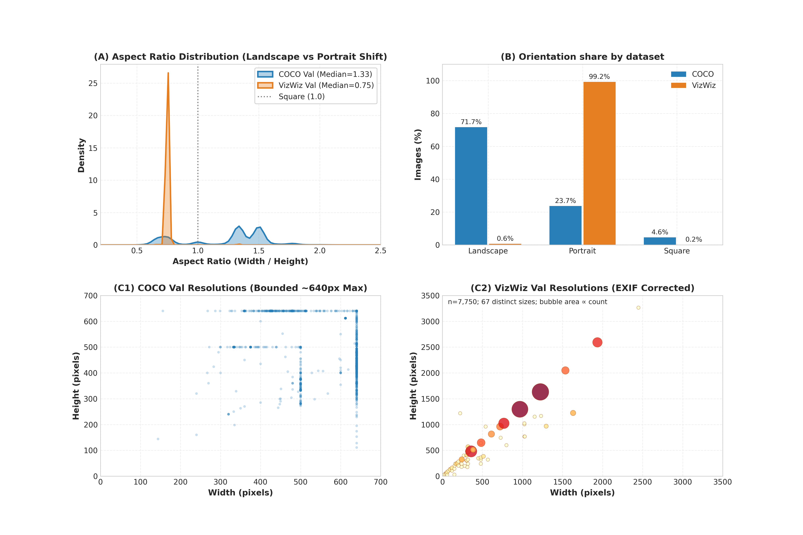
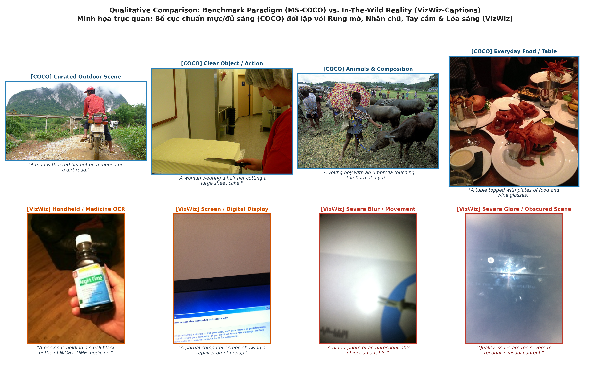

# 🔬 EDA: MS-COCO vs VizWiz-Captions

## Sau EDA: chuẩn bị dữ liệu cho mô hình

Chạy `python prepare_data.py --verify-images` để tạo manifest train/dev/eval và kiểm tra ảnh val. Xem [hướng dẫn dữ liệu đã chuẩn bị](data_prepared/README.md). Ảnh train hiện chưa có trong thư mục này; cần bổ sung trước khi fine-tune.

**Nhãn object VizWiz chưa hoàn thành:** `data_prepared/vizwiz_object_annotation_worklist.csv` là mẫu trống, hiện cả 1.000 dòng A/B đều là `unlabeled`. Không sử dụng file này như ground truth.

**EDA dành cho LLaVA-1.5-7B đã tích hợp vào [báo cáo chính](EDA_COCO_vs_VizWiz_Report.md#phần-8-kiểm-tra-eda-bổ-sung-cho-llava-15-7b) và notebook.** Kiểm tra trực tiếp file instruction tuning LLaVA 665K, nhãn lỗi VizWiz, độ đầy đủ nhãn object từ caption, hình học pad/resize, CLIP có và không pad, cùng manifest eval. File `coco/annotations/instances_train2017.json` từ [gói annotation COCO 2017 chính thức](http://images.cocodataset.org/annotations/annotations_trainval2017.zip) chỉ dùng cho đối chứng train2017; không thay thế danh sách ảnh LLaVA thực sự dùng.

### Nghiên cứu Chuyên sâu về Domain Gap trong Trợ lý Thị giác Hỗ trợ Người Khiếm thị
*Đề tài Khóa Luận Tốt Nghiệp — Image Captioning & Multimodal Vision-Language Models*

---

## 📌 Tổng Quan Dự Án

Kho lưu trữ này chứa toàn bộ mã nguồn phân tích khám phá dữ liệu (EDA), biểu đồ trực quan hóa độ phân giải cao, bảng số liệu thống kê chi tiết và file báo cáo Jupyter Notebook đối sánh giữa hai tập dữ liệu thị giác lớn:
- **MS-COCO val2014:** 40.504 ảnh có caption và instance annotation; dùng làm tập đối chiếu.
- **VizWiz-Captions (Thực tế Hỗ trợ Đời thực):** Tập dữ liệu chụp từ góc nhìn thứ nhất (egocentric) của người khiếm thị qua điện thoại thông minh, phục vụ việc giải quyết các câu hỏi thường nhật.

---

## 🎯 6 Phát Hiện Định Lượng Cốt Lõi

1. **Đảo ngược Tỷ lệ Khung hình (Aspect Ratio Inversion):**
   - COCO chiếm **71.71% ảnh ngang (Landscape)**.
   - VizWiz có **99.23% ảnh dọc** sau EXIF transpose.
2. **Kích thước file ảnh:**
   - Kích thước file COCO trung bình $576.5 \times 485.1\text{px}$ (0.28 MP).
   - Kích thước file VizWiz sau EXIF trung bình $1032.1 \times 1374.7\text{px}$ (1.57 MP), có ngoại lai rộng 23 px. Đây là kích thước file được khảo sát; COCO trong bộ này có cạnh tối đa 640 px, nên không dùng chênh lệch pixel để suy ra độ phân giải cảm biến hoặc chất lượng ảnh gốc.
3. **Chỉ báo chi tiết tần số cao:**
   - Trên toàn bộ val, sau EXIF transpose và resize cạnh ngắn 480 px, median Laplacian là **1.140,08** (COCO; 40.504 ảnh) và **152,16** (VizWiz; 7.750 ảnh). Đây là chỉ báo biên/texture; bảng theo mức từ chối và độ nhạy resize cũng dùng toàn bộ val.
4. **Tín hiệu ảnh không thể nhận diện:**
   - **32.62%** ảnh có ít nhất 1/5 annotator dùng caption từ chối; tỷ lệ đồng thuận đa số **≥3/5 là 9.69%**, và 5/5 là **2.48%**.
5. **Nhu cầu Nhận diện Chữ viết (Scene Text / OCR Relevance):**
   - **73.72%** ảnh có ít nhất 1/5 annotator đánh dấu có chữ; tỷ lệ đồng thuận đa số **≥3/5 là 64.75%**.
6. **Lệch pha Ngữ nghĩa (Semantic Shift):**
    - Trong annotation instance COCO, `person` chiếm **30.20%** số object; đây là đơn vị khác với tần suất từ trong caption.
    - Với một caption hợp lệ có ID thấp nhất mỗi ảnh, VizWiz nhắc `screen` 90,69 và `computer` 89,90 lần/1.000 caption; COCO nhắc `man` 131,35 và `people` 68,59. Có 208 ảnh VizWiz không còn caption hợp lệ sau lọc.

---

## 📂 Cấu Trúc Thư Mục

```bash
├── EDA_COCO_vs_VizWiz_Report.ipynb    # Báo cáo Jupyter Notebook hoàn chỉnh (nhúng sẵn hình ảnh & bảng biểu)
├── EDA_COCO_vs_VizWiz_Report.md       # Báo cáo Markdown chi tiết phục vụ khóa luận tốt nghiệp
├── eda_coco_vs_vizwiz.py             # Script Python tính toán và kết xuất toàn bộ số liệu & biểu đồ
├── vlm_eda_extensions.py             # Kiểm tra EDA VLM của Phần 8 trong báo cáo chính
├── caption_sampling_sensitivity.py    # Kiểm tra caption hợp lệ có ID thấp nhất mỗi ảnh
├── clip_embedding_audit.py            # Đo CLIP image embedding và image–caption cosine
├── llava_preprocessing_audit.py       # Hình học crop/pad/resize cho 336×336
├── audit_val_images.py                # Giải mã, MD5 và pHash toàn bộ ảnh val
├── full_laplacian_audit.py            # Laplacian 480 px toàn bộ ảnh val
├── summarize_full_laplacian.py        # Phân tầng Laplacian trên toàn bộ val
├── llava_training_overlap.py          # Đối chiếu file mix665k chính thức
├── pope_manifest_audit.py             # Đối chiếu danh sách POPE COCO chính thức
├── vizwiz_quality_audit.py            # Ghép nhãn lỗi chất lượng chính thức
├── coco_caption_label_completeness.py # Độ đầy đủ lớp object lấy từ caption COCO
├── plot_coco80_mentions.py            # Hình 4: từ COCO-80 ở hai tập
├── plot_vlm_findings.py               # Hình CLIP và nhãn chất lượng
├── llava_pilot.py                      # Pilot 100+100 khi có checkpoint 7B
├── build_eda_notebook.py              # Script tự động đóng gói toàn bộ dữ liệu vào file Notebook
├── run_eda_notebook.py                # Chạy lại mọi code cell trong kernel mới và lưu output thật
├── eda_results/
│   ├── figures/                       # Biểu đồ EDA; hình CLIP và nhãn lỗi ở 220 DPI
│   │   ├── 01_dataset_splits_comparison.png
│   │   ├── 02_resolution_aspect_ratio.png
│   │   ├── 03_caption_length_and_tokens.png
│   │   ├── 04_coco_category_distribution.png
│   │   ├── 05_vizwiz_quality_and_text_issues.png
│   │   ├── 07_qualitative_samples_grid.png
│   │   ├── 08_clip_domain_alignment.png
│   │   └── 09_vizwiz_quality_labels.png
│   ├── tables/                        # Các bảng số liệu CSV
│   │   ├── dataset_overview.csv
│   │   ├── resolution_aspect_ratio.csv
│   │   ├── caption_stats.csv
│   │   ├── coco_supercategories.csv
│   │   ├── coco_categories.csv
│   │   ├── vizwiz_quality_breakdown.csv
│   │   ├── caption_noun_entities_top15.csv
│   │   ├── laplacian_by_precanned_full.csv
│   │   ├── laplacian_resize_sensitivity_full.csv
│   │   ├── person_reference_summary.csv
│   │   ├── person_reference_one_caption_per_image.csv
│   │   └── qualitative_samples_manifest.csv
│   └── eda_summary_metrics.json       # Tổng hợp toàn bộ chỉ số định lượng dưới dạng JSON
└── README.md
```

---

## 🚀 Hướng Dẫn Tái Lập (Reproducibility)

### 1. Cài đặt Môi trường
```bash
pip install -r requirements-eda.txt
```

### 2. Chạy Phân Tích & Sinh Lại Kết Quả
```bash
python full_laplacian_audit.py
python eda_coco_vs_vizwiz.py
python summarize_full_laplacian.py
python vlm_eda_extensions.py
python caption_sampling_sensitivity.py
python llava_preprocessing_audit.py
python audit_val_images.py
python plot_coco80_mentions.py
python coco_caption_label_completeness.py
python llava_training_overlap.py
python vizwiz_quality_audit.py
python pope_manifest_audit.py
python clip_embedding_audit.py
python plot_vlm_findings.py
```

`clip_embedding_audit.py` đọc checkpoint `openai/clip-vit-large-patch14-336` từ `model_assets/clip-vit-large-patch14-336/`. Cần tải `config.json`, `preprocessor_config.json`, `merges.txt`, `vocab.json`, `tokenizer_config.json` và `pytorch_model.bin` từ [model card](https://huggingface.co/openai/clip-vit-large-patch14-336). Phép đếm token dùng `model_assets/llava-v1.5-7b/tokenizer.model` từ [checkpoint LLaVA](https://huggingface.co/liuhaotian/llava-v1.5-7b). Các trọng số tải về được bỏ qua bởi `.gitignore`.

Ba script đối chiếu nguồn ngoài đọc file trong `scratch/` (thư mục bị Git bỏ qua): tải [`llava_v1_5_mix665k.json`](https://huggingface.co/datasets/liuhaotian/LLaVA-Instruct-150K/blob/main/llava_v1_5_mix665k.json) vào `scratch/llava_v1_5_mix665k.json`, [VizWiz-QualityIssues annotations.zip](https://vizwiz.org/tasks-and-datasets/image-quality-issues/) vào `scratch/vizwiz_quality_annotations.zip`, và [POPE COCO random](https://github.com/RUCAIBox/POPE/blob/main/output/coco/coco_pope_random.json) vào `scratch/coco_pope_random.json` trước khi chạy `llava_training_overlap.py`, `vizwiz_quality_audit.py` và `pope_manifest_audit.py`. Kết quả CSV/JSON ghi hash nguồn. Chạy `python prepare_data.py --verify-images` lại sau khi có `val_image_hashes.csv` để loại ảnh dev trùng byte với eval.

Pilot LLaVA chốt prompt, `max_new_tokens=64` và greedy trong `llava_pilot.py`. Máy hiện có tokenizer và CLIP, **chưa có trọng số LLaVA 7B**, nên chưa có output mô hình; script yêu cầu checkpoint cục bộ, không tải ngầm. Cài `requirements-llava-pilot.txt` và chạy trên máy đủ bộ nhớ sau khi có checkpoint.

### 3. Đóng Gói Lại File Báo Cáo Notebook
```bash
python build_eda_notebook.py
python run_eda_notebook.py
```

---

## 📊 Biểu Đồ Trực Quan Tiêu Biểu

### Phân bố tỷ lệ khung hình và độ phân giải


### Lưới Ảnh Đối Sánh Định Tính 8 Trường Hợp Mẫu


---

## 🎓 Giả thuyết cho thực nghiệm tiếp theo

1. So sánh cơ chế từ chối với mô hình gốc trên từng mức đồng thuận caption từ chối.
2. So sánh bật/tắt OCR trên ảnh có và không có chữ, đo độ chính xác thông tin chữ.
3. So sánh tiền xử lý ảnh và tăng cường dữ liệu trên cùng mô hình, đo nội dung bị cắt và sai số đầu ra.

---
*Cập nhật: 2026-10-05 — Đã đồng bộ đầy đủ mã nguồn, báo cáo EDA và tài nguyên lên nhánh EDA.*

